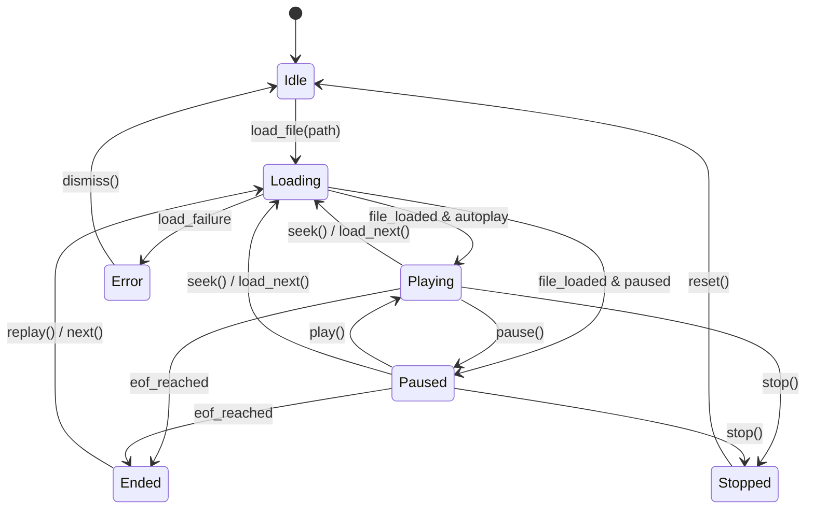

# Velo — Master Architecture & Implementation Plan

> **Document Version**: 1.0.0  
> **Status**: Proposed / Under Architectural Review  
> **Author**: Lead Software Architect  
> **Target Platforms**: macOS (Apple Silicon), Windows (x64)

---

## Table of Contents

1. [Project Goals](#1-project-goals)
2. [Non-Goals](#2-non-goals)
3. [Supported Platforms](#3-supported-platforms)
4. [Technology Decisions](#4-technology-decisions)
5. [System Architecture](#5-system-architecture)
6. [Frontend Architecture](#6-frontend-architecture)
7. [Rust Architecture](#7-rust-architecture)
8. [libmpv Integration Strategy](#8-libmpv-integration-strategy)
9. [Video Rendering Architecture](#9-video-rendering-architecture)
10. [macOS Rendering Strategy](#10-macos-rendering-strategy)
11. [Windows Rendering Strategy](#11-windows-rendering-strategy)
12. [Hardware Decoding Strategy](#12-hardware-decoding-strategy)
13. [IPC Design](#13-ipc-design)
14. [Event Architecture](#14-event-architecture)
15. [Player State Model](#15-player-state-model)
16. [Playlist Architecture](#16-playlist-architecture)
17. [Settings & Persistence](#17-settings--persistence)
18. [Error Handling](#18-error-handling)
19. [Performance Considerations](#19-performance-considerations)
20. [Security Considerations](#20-security-considerations)
21. [Dependency Strategy](#21-dependency-strategy)
22. [Licensing & Distribution](#22-licensing--distribution)
23. [Testing Strategy](#23-testing-strategy)
24. [CI/CD Strategy](#24-cicd-strategy)
25. [Packaging Strategy](#25-packaging-strategy)
26. [Repository Structure](#26-repository-structure)
27. [Implementation Phases (0 to 10)](#27-implementation-phases-0-to-10)
28. [Technical Risks & Mitigations](#28-technical-risks--mitigations)
29. [Open Questions](#29-open-questions)
30. [Definition of Done (DoD) by Phase](#30-definition-of-done-dod-by-phase)
31. [Meeting Summarization (Phase 2)](#31-meeting-summarization-phase-2)

---

## 1. Project Goals

Velo is designed as a modern, ultra-fast, lightweight, open-source desktop video player for macOS and Windows.

* **Sub-500ms Cold Startup**: Rapid initialization from process spawn to interactive UI.
* **Low Memory Footprint**: < 80MB idle, ~150MB active 4K playback.
* **Zero-Copy Native Video Rendering**: Hardware-accelerated decoding and direct GPU presentation without intermediate frame copies or IPC serialization.
* **Flawless Codec & Subtitle Compatibility**: Comprehensive format support (MP4, MKV, MOV, AVI, WebM; H.264, HEVC/H.265, AV1, VP9) and pixel-perfect subtitle rendering (ASS/SSA, SRT, VTT, embedded/external) powered by `libmpv` and `libass`.
* **Modern Desktop UX**: Sleek, distraction-free interface with auto-fading overlay controls, dark/light themes, keyboard shortcuts, and smooth animations.
* **Reliability & Stability**: Strict error typing, zero-panic Rust backend, decoupled state management, and resilient error recovery.
* **Open Source Contributor-Friendly**: Modular codebase, comprehensive documentation, strict typing, automated CI, and straightforward build steps.

---

## 2. Non-Goals

To maintain high performance and simplicity, the following are explicitly out of scope:

* **Media Server Ecosystem / Streaming Catalog**: Velo is a local media player, not a Plex, Emby, or Jellyfin server/client.
* **Video Editing / Transcoding**: Velo will not include video re-encoding, trimming, filtering, or conversion tools.
* **Electron Runtime**: Velo will never use Electron due to memory overhead and binary bloat.
* **HTML5 `<video>` / WebCodecs Frame Blitting**: Velo will not decode frames to JavaScript/Canvas or push raw video frames across Tauri IPC.
* **P2P / Torrent Ingestion**: Velo will not bundle torrent engines or unauthorized streaming scrapers.

---

## 3. Supported Platforms

| Platform | Architecture | OS Version | Tier | Priority |
| :--- | :--- | :--- | :--- | :--- |
| **macOS** | Apple Silicon (`aarch64-apple-darwin`) | macOS 12 (Monterey) or later | Tier 1 | Release Blocker |
| **Windows** | x64 (`x86_64-pc-windows-msvc`) | Windows 10 / 11 64-bit | Tier 1 | Release Blocker |
| **macOS** | Intel (`x86_64-apple-darwin`) | macOS 12 or later | Tier 2 | Post-V1 Target |
| **Linux** | x86_64 (Wayland / X11) | Modern glibc Linux distributions | Tier 3 | Future Consideration |

---

## 4. Technology Decisions

### Architectural Decision Records (ADRs)

#### ADR-01: Application Framework — Tauri v2
* **Decision**: Use **Tauri v2** over Electron and Qt.
* **Reason**: Tauri utilizes the operating system's native webview (WKWebView on macOS, WebView2 on Windows) and a native Rust backend. This yields a sub-15MB binary, low memory footprint, and direct access to native OS APIs and C dynamic libraries (`libmpv`).
* **Alternatives Considered**: 
  * *Electron*: High memory overhead (150MB+ idle), heavy binary (>100MB), complex multi-process video frame plumbing.
  * *Qt 6 / QML*: Fast native performance, but slower UI iteration, complex cross-platform styling, and heavy C++ toolchain requirements for open-source contributors.
  * *Flutter Desktop*: Immature multi-window and C video embedding ecosystem on macOS/Windows.
* **Trade-offs**: Requires platform-specific native child window/view hierarchy manipulation to place native video surfaces underneath transparent webviews.

#### ADR-02: Video Playback Engine — libmpv
* **Decision**: Integrate `libmpv` as a shared dynamic library (`.dylib` on macOS, `.dll` on Windows) linked to the Rust backend.
* **Reason**: `libmpv` offers world-class demuxing, decoding (via FFmpeg), audio/video synchronization, subtitle rendering (`libass`), and GPU presentation pipelines (`vo=gpu-next`).
* **Alternatives Considered**:
  * *libVLC*: Heavier runtime footprint, less flexible subtitle styling, and less configurable `vo` rendering parameters.
  * *Custom FFmpeg + WGPU pipeline*: Extreme engineering complexity to replicate A/V sync, format demuxing, tone mapping, and subtitle layout engines.
* **Trade-offs**: Native library distribution, dynamic linking, and cross-platform build toolchain setup require careful packaging.

#### ADR-03: Frontend Architecture — Vue 3 + TypeScript + Vite + Pinia
* **Decision**: Build the UI layer with **Vue 3** (Composition API, `<script setup>`), **TypeScript** (Strict mode), **Vite**, and **Pinia**.
* **Reason**: Vue 3's reactive proxy model provides high UI responsiveness without React's virtual DOM re-render overhead. Pinia offers a type-safe, lightweight store architecture for player and playlist state.
* **Alternatives Considered**:
  * *React*: Higher re-render frequency and state overhead during rapid timeline updates.
  * *Svelte*: Compact output, but smaller desktop-focused UI component ecosystem.
* **Trade-offs**: Custom desktop controls and draggable title bars must be explicitly wired through CSS and Tauri window APIs.

#### ADR-04: Styling & UI Components — Tailwind CSS + Scoped CSS + Lucide Icons
* **Decision**: Use **Tailwind CSS** with scoped component styles and **lucide-vue-next** for vector icons.
* **Reason**: Zero runtime CSS overhead, atomic utility classes, seamless dark/light theme switching via CSS variables, and crisp SVG iconography.

---

## 5. System Architecture

Velo uses a **Layered Hybrid Architecture**: a platform-native GPU rendering surface sits directly underneath a transparent webview UI layer, coordinated by a high-performance Rust service.

```
┌────────────────────────────────────────────────────────────────────────┐
│                          Vue 3 Overlay UI                              │
│  [TopBar / Controls]   [Timeline Slider]   [Modals / Toasts / Drawers] │
│  (CSS: background: transparent; pointer-events: none on video zone)    │
└───────────────────────────────────┬────────────────────────────────────┘
                                    │ Tauri IPC (Commands & Events)
┌───────────────────────────────────▼────────────────────────────────────┐
│                         Tauri Rust Backend                             │
│  ┌───────────────────┐  ┌────────────────────┐  ┌───────────────────┐  │
│  │  Command Handlers │  │   Player Manager   │  │   Settings Store  │  │
│  └─────────┬─────────┘  └──────────┬─────────┘  └───────────────────┘  │
│            │                       │                                   │
│            │              ┌────────▼────────┐                          │
│            │              │ Dedicated Event │                          │
│            │              │   Loop Thread   │                          │
│            │              └────────┬────────┘                          │
│            ▼                       ▼                                   │
│  ┌───────────────────────────────────────────┐                         │
│  │         Safe Rust libmpv Wrapper          │                         │
│  └─────────────────────┬─────────────────────┘                         │
└────────────────────────┼───────────────────────────────────────────────┘
                         │ Native C API / Window Handle (wid)
┌────────────────────────▼───────────────────────────────────────────────┐
│                           libmpv Engine                                │
│  ┌───────────────┐  ┌─────────────────────────┐  ┌──────────────────┐  │
│  │ FFmpeg Demux  │  │  VideoToolbox / D3D11VA │  │ libass Subtitles │  │
│  └───────────────┘  └────────────┬────────────┘  └──────────────────┘  │
│                                  ▼                                     │
│                     GPU Video Output (vo=gpu-next)                     │
└──────────────────────────────────┬─────────────────────────────────────┘
                                   │ Direct Presentation
┌──────────────────────────────────▼─────────────────────────────────────┐
│                       Native OS Rendering Surface                      │
│        macOS: NSView / CALayer         Windows: Child HWND (Direct3D)  │
└────────────────────────────────────────────────────────────────────────┘
```

---

## 6. Frontend Architecture

### Directory Structure
```
src/
├── assets/                 # SVGs, base CSS, fonts
│   └── styles/
│       ├── main.css        # Tailwind base & global transparency rules
│       ├── theme.css       # Light/Dark CSS custom properties
│       └── transitions.css # Smooth fade/slide animations
├── components/
│   ├── common/             # Reusable UI primitives
│   │   ├── IconButton.vue
│   │   ├── Modal.vue
│   │   ├── Slider.vue
│   │   ├── Toast.vue
│   │   └── Tooltip.vue
│   ├── player/             # Video player UI
│   │   ├── AudioTrackSelector.vue
│   │   ├── ControlOverlay.vue
│   │   ├── MediaInfoModal.vue
│   │   ├── SpeedSelector.vue
│   │   ├── SubtitleTrackSelector.vue
│   │   ├── TimelineBar.vue
│   │   ├── TopBar.vue
│   │   └── VolumeControl.vue
│   ├── playlist/           # Playlist components
│   │   ├── PlaylistDrawer.vue
│   │   └── PlaylistItem.vue
│   └── settings/           # Settings panels
│       ├── AudioSettings.vue
│       ├── GeneralSettings.vue
│       ├── SettingsModal.vue
│       ├── SubtitleSettings.vue
│       └── VideoSettings.vue
├── composables/            # Reusable business logic & state hooks
│   ├── useAutoHideControls.ts
│   ├── useDragAndDrop.ts
│   ├── useFullscreen.ts
│   ├── useKeyboardShortcuts.ts
│   ├── usePlayer.ts
│   ├── usePlaylist.ts
│   ├── useSettings.ts
│   └── useToast.ts
├── services/               # Tauri IPC communication bridges
│   ├── playerService.ts
│   ├── playlistService.ts
│   ├── settingsService.ts
│   └── shortcutRegistry.ts
├── stores/                 # Pinia reactive state stores
│   ├── playerStore.ts
│   ├── playlistStore.ts
│   ├── settingsStore.ts
│   └── uiStore.ts
├── types/                  # TypeScript interface declarations
│   ├── events.ts
│   ├── player.ts
│   ├── playlist.ts
│   └── settings.ts
├── utils/                  # Pure utility functions
│   ├── constants.ts
│   ├── formatters.ts
│   └── time.ts
├── App.vue                 # Root application component
└── main.ts                 # Vue application entry point
```

### Overlay Transparency & Mouse Interaction Model
* **Transparent Webview Base**: The `html`, `body`, and `#app` elements are set to `background: transparent;`.
* **Pointer Events Strategy**:
  * The root overlay container defaults to `pointer-events: none;`.
  * Interactive UI controls (TopBar, Bottom Control Bar, Timeline, Modals, Drawers) have `pointer-events: auto;`.
  * Click/drag gestures on the empty video area are captured by an invisible click handler that dispatches play/pause, double-click fullscreen, and window-dragging commands to Rust.
* **Auto-Hiding Controls (`useAutoHideControls`)**:
  * An inactivity timer (default 2500ms) tracks `mousemove`, `mousedown`, and `keydown`.
  * While playing, the control bar and cursor fade out (`opacity: 0; cursor: none;`).
  * On mouse movement or when paused, controls immediately restore opacity.

---

## 7. Rust Architecture

### Module Hierarchy
```
src-tauri/src/
├── commands/               # Tauri IPC command entry points
│   ├── mod.rs
│   ├── player.rs           # Play, pause, seek, load, volume, speed
│   ├── playlist.rs         # Playlist operations & queue management
│   ├── settings.rs         # Persistent settings reads/writes
│   └── tracks.rs           # Audio & subtitle track selection
├── errors/                 # Centralized typed error definitions
│   ├── mod.rs
│   ├── player_error.rs
│   └── storage_error.rs
├── platform/               # OS-specific native view & power management
│   ├── mod.rs
│   ├── macos.rs            # NSView hierarchy, sleep assertion
│   └── windows.rs          # Child HWND, SetThreadExecutionState
├── player/                 # Core libmpv abstraction & management
│   ├── mod.rs
│   ├── core.rs             # Safe wrapper around libmpv C pointers
│   ├── events.rs           # Background event listener thread
│   ├── manager.rs          # PlayerManager facade & synchronization
│   ├── properties.rs       # Type-safe mpv property observation
│   └── types.rs            # Rust structs mapped to IPC payloads
├── storage/                # App data persistence (JSON/Atomic write)
│   ├── mod.rs
│   ├── history_store.rs    # Recent files & resume timestamps
│   └── settings_store.rs   # Persistent user preferences
├── lib.rs                  # Tauri builder setup & state injection
└── main.rs                 # Native binary entry point
```

### Threading & Concurrency Model
* **Main UI Thread**: Runs the Tauri window event loop and WebView message dispatcher.
* **`PlayerManager`**: Wrapped in `tauri::State<Arc<PlayerManager>>`. Uses internal `parking_lot::Mutex` or `std::sync::RwLock` for fast, non-blocking state access.
* **Dedicated MPV Event Thread**:
  * Spawns an isolated OS thread via `std::thread::Builder::new().name("velo-mpv-events")`.
  * Calls `mpv_wait_event(mpv_handle, 0.25)` in an infinite loop.
  * Translates raw C events into typed Rust structs and emits them asynchronously to the frontend via `AppHandle::emit`.
  * Offloads heavy processing from both the Tauri main thread and mpv's internal rendering thread.

---

## 8. libmpv Integration Strategy

### Safe Rust Wrapper Design
Direct calls to raw `libmpv` C functions are strictly encapsulated inside `player/core.rs`. No raw C pointers (`*mut mpv_handle`) are exposed outside this boundary.

```rust
pub struct MpvCore {
    handle: *mut mpv_handle,
}

unsafe impl Send for MpvCore {}
unsafe impl Sync for MpvCore {}
```

### Property Observation
Instead of polling mpv for playback position and state, Velo leverages `mpv_observe_property`:

| mpv Property | Format | Rust Event Target | Throttling |
| :--- | :--- | :--- | :--- |
| `pause` | `MPV_FORMAT_FLAG` | `velo://player-state` | Immediate |
| `time-pos` | `MPV_FORMAT_DOUBLE` | `velo://time-update` | Throttled (10Hz / 100ms) |
| `duration` | `MPV_FORMAT_DOUBLE` | `velo://media-loaded` | Immediate |
| `volume` | `MPV_FORMAT_DOUBLE` | `velo://volume-changed` | Immediate |
| `mute` | `MPV_FORMAT_FLAG` | `velo://volume-changed` | Immediate |
| `speed` | `MPV_FORMAT_DOUBLE` | `velo://speed-changed` | Immediate |
| `track-list` | `MPV_FORMAT_NODE` | `velo://tracks-changed` | Immediate |
| `eof-reached` | `MPV_FORMAT_FLAG` | `velo://playback-ended` | Immediate |

### Command Dispatch
All playback actions are dispatched via `mpv_command_async` or safe synchronous wrappers with strict error checks:
* `loadfile <url> replace`
* `seek <seconds> relative+exact`
* `set pause <yes/no>`
* `set volume <0-100>`
* `set speed <0.25-2.0>`
* `sub-add <path> select`

---

## 9. Video Rendering Architecture

### Evaluation of Rendering Strategies

```
┌────────────────────────────────────────────────────────────────────────┐
│                    Video Rendering Approaches Compared                 │
├────────────────────────────┬───────────────────────────────────────────┤
│ Approach                   │ Verdict & Technical Assessment            │
├────────────────────────────┼───────────────────────────────────────────┤
│ 1. Frame Copy via IPC      │ REJECTED. Copying 4K 60fps 10-bit YUV     │
│    (mpv -> Rust -> IPC     │ to JS/Canvas consumes ~1.5GB/s bandwidth, │
│     -> Canvas/WebGL)       │ causing high CPU/RAM load & dropped frames│
├────────────────────────────┼───────────────────────────────────────────┤
│ 2. mpv_render_context      │ ACCEPTABLE, but requires writing a custom │
│    with Metal/Direct3D FBO │ swapchain, vsync loop, and window resize  │
│                            │ synchronization in Rust.                  │
├────────────────────────────┼───────────────────────────────────────────┤
│ 3. Native Child Surface    │ SELECTED (RECOMMENDED). Creates a native  │
│    Underlay (wid)          │ child window/view behind the transparent  │
│                            │ WebView. mpv manages its own optimized    │
│                            │ swapchain, vsync, and hardware overlays.  │
└────────────────────────────┴───────────────────────────────────────────┘
```

### The Chosen Strategy: Native Child Surface Underlay (`wid`)
1. During window initialization in Rust, a native child view (`NSView` on macOS, child `HWND` on Windows) is instantiated.
2. The child view is placed at index 0 (beneath the WebView) in the native window's view hierarchy and pinned to fill the entire client area.
3. The native handle (pointer / integer) is passed to `libmpv` using the `wid` option.
4. `libmpv` initializes its native GPU rendering swapchain (`vo=gpu-next`) directly into this surface.
5. The Tauri WebView sits on top with transparency enabled, displaying controls, menus, and subtitles when needed, while the video renders at full native refresh rates with zero IPC overhead.

---

## 10. macOS Rendering Strategy

```
┌────────────────────────────────────────────────────────┐
│               macOS Window View Hierarchy              │
├────────────────────────────────────────────────────────┤
│  NSWindow (Tauri Main Window)                          │
│   └── contentView (NSView)                             │
│        ├── Child Video NSView (libmpv wid) [Layer 0]   │
│        │    └── CALayer / CAMetalLayer (Direct Metal)  │
│        └── WKWebView (Tauri UI Overlay)    [Layer 1]   │
│             └── drawsBackground = NO (Transparent)     │
└────────────────────────────────────────────────────────┘
```

### Implementation Details:
* **Window Configuration**: `transparent: true`, `decorations: false` (or custom title bar with standard macOS traffic light buttons).
* **WKWebView Setup**: Set `drawsBackground = NO` via Cocoa Objective-C / `objc2` bindings in `platform/macos.rs`.
* **Hardware Decoding**: `hwdec=videotoolbox` (zero-copy hardware decoding to Apple Silicon GPU textures).
* **Resize Handling**: The child `NSView` is configured with `NSViewWidthSizable | NSViewHeightSizable` autoresizing mask so resizing the main window automatically adjusts the video view with zero lag.
* **Sleep Prevention**: Use macOS `IOPMAssertionCreateWithName(kIOPMAssertionTypeNoDisplaySleep, ...)` when playback is active; release assertion when paused or stopped.

---

## 11. Windows Rendering Strategy

```
┌────────────────────────────────────────────────────────┐
│              Windows HWND View Hierarchy               │
├────────────────────────────────────────────────────────┤
│  Main Parent HWND (Tauri Window)                       │
│   ├── Child HWND (libmpv wid) [WS_CHILD | WS_VISIBLE]  │
│   │    └── Direct3D 11 Swapchain (D3D11VA / Zero-Copy) │
│   └── WebView2 Controller (Tauri UI)                   │
│        └── DefaultBackgroundColor = 0x00000000 (Trans) │
└────────────────────────────────────────────────────────┘
```

### Implementation Details:
* **Child HWND Creation**: Create a native Win32 child window using `CreateWindowExW` with `WS_CHILD | WS_VISIBLE | WS_CLIPSIBLINGS`.
* **WebView2 Transparency**: Configure `ICoreWebView2Controller2::put_DefaultBackgroundColor(COREWEBVIEW2_COLOR{0, 0, 0, 0})`.
* **Hardware Decoding**: `hwdec=d3d11va` with fallback to `dxva2`.
* **Window Resizing**: Intercept parent window `WM_SIZE` messages or use Win32 `SetWindowPos` to keep the child HWND synchronized with the client rect.
* **DPI Awareness**: Set `Per-Monitor V2 DPI awareness` in Tauri manifest to prevent scaling blur on multi-monitor setups.
* **Sleep Prevention**: Call `SetThreadExecutionState(ES_CONTINUOUS | ES_DISPLAY_REQUIRED | ES_SYSTEM_REQUIRED)` during playback.

---

## 12. Hardware Decoding Strategy

### Configuration Defaults
```ini
# Default mpv configuration for Velo
vo=gpu-next
gpu-api=auto
hwdec=auto-safe
hwdec-codecs=all
target-colorspace-hint=yes
tone-mapping=auto
dither-depth=auto
```

### Platform Hardware Decoder Matrix
* **macOS (Apple Silicon)**: `videotoolbox` (Hardware decoders for H.264, HEVC 8/10-bit, ProRes, AV1 on M3/M4).
* **Windows (x64)**: `d3d11va` (DirectX Video Acceleration on NVIDIA, AMD, and Intel GPUs), with automatic fallback to `dxva2` or software decoding (`no`) for unsupported legacy formats.

---

## 13. IPC Design

### Tauri Commands (Frontend -> Rust)

```typescript
// Player Commands
player_load_file(path: string, startTime?: number): Promise<void>
player_play(): Promise<void>
player_pause(): Promise<void>
player_toggle_play(): Promise<void>
player_stop(): Promise<void>
player_seek(seconds: number, exact: boolean): Promise<void>
player_set_volume(volume: number): Promise<void>
player_set_mute(muted: boolean): Promise<void>
player_set_speed(speed: number): Promise<void>
player_set_aspect_ratio(ratio: string): Promise<void>

// Track Commands
player_select_audio_track(trackId: number): Promise<void>
player_select_subtitle_track(trackId: number): Promise<void>
player_add_external_subtitle(path: string): Promise<void>
player_set_subtitle_delay(seconds: number): Promise<void>
player_set_audio_delay(seconds: number): Promise<void>

// Playlist Commands
playlist_add_items(paths: string[]): Promise<void>
playlist_remove_item(id: string): Promise<void>
playlist_clear(): Promise<void>
playlist_move_item(fromIndex: number, toIndex: number): Promise<void>
playlist_play_index(index: number): Promise<void>
playlist_next(): Promise<void>
playlist_previous(): Promise<void>

// Settings Commands
settings_get_all(): Promise<AppSettings>
settings_update(settings: Partial<AppSettings>): Promise<void>
settings_reset(): Promise<AppSettings>
```

---

## 14. Event Architecture

### Tauri Events (Rust -> Frontend Broadcast)

```typescript
// Event: "velo://player-state"
interface PlayerStateEvent {
  state: 'idle' | 'loading' | 'playing' | 'paused' | 'stopped' | 'ended' | 'error';
}

// Event: "velo://time-update" (Throttled to 10Hz)
interface TimeUpdateEvent {
  currentTime: number;
  duration: number;
  bufferPercent: number;
}

// Event: "velo://media-loaded"
interface MediaLoadedEvent {
  filePath: string;
  fileName: string;
  duration: number;
  width: number;
  height: number;
  videoCodec: string;
  audioCodec: string;
  chapters: Chapter[];
}

// Event: "velo://tracks-changed"
interface TracksChangedEvent {
  audioTracks: Track[];
  subtitleTracks: Track[];
  selectedAudioId: number;
  selectedSubtitleId: number;
}

// Event: "velo://volume-changed"
interface VolumeChangedEvent {
  volume: number;
  muted: boolean;
}

// Event: "velo://speed-changed"
interface SpeedChangedEvent {
  speed: number;
}

// Event: "velo://error"
interface PlayerErrorEvent {
  code: string;
  message: string;
  recoverable: boolean;
}
```

---

## 15. Player State Model

### State Transition Diagram



### Source of Truth Allocation
* **libmpv (Authoritative)**: Video time, duration, track availability, playback status, hardware decode status.
* **Rust Backend (Authoritative)**: Persistent project library, persistence manager, native window handles.
* **Pinia Frontend (Authoritative)**: UI overlay visibility, modal open states, active theme, transient slider drag values.

---

## 16. Playlist Architecture

### Project library (local implementation, October 2026)

The current playback queue lives in Pinia (`playlistStore`); it is transient.
The reading sidebar now browses a separate Rust-backed project library. Naming,
grouping, pinning, searching and sorting library entries do not reorder the queue
or rename media files. Selecting an entry adds it to the queue if necessary and
plays by original path. Removing it from the library does not stop playback or
delete its queue entry, media, transcript or summary.

`storage/library` owns version1 `library.json` in Tauri's actual `app_data_dir`
(bundle-identifier scoped, including isolated Previews). It stores stable IDs,
original paths, optional display names/projects/durations, pins, timestamps and
sort/collapse preferences. History/resume and cache identity stay path-based.
Typed mutations are serialized and revision checked; snapshots publish only
after atomic replacement succeeds. Corrupt or unsupported data blocks library
writes without replacing the file or blocking direct playback. No history is
automatically imported and restoring the library never autoplays.

The following queue model describes playback separately; the earlier references
to a Rust queue/reordering are architectural intentions, not current ownership.

### Domain Model
```typescript
interface PlaylistItem {
  id: string;             // UUID v4
  path: string;           // Absolute filesystem path
  fileName: string;       // Basename (e.g., "Movie.mkv")
  duration: number;       // In seconds (0 if unprobed)
  lastPosition?: number;  // Resume timestamp
  thumbnail?: string;     // Optional cache key
}

interface PlaylistState {
  items: PlaylistItem[];
  currentIndex: number;
  loopMode: 'off' | 'all' | 'single';
  shuffle: boolean;
  autoPlayNext: boolean;
}
```

### Features:
* **Folder Ingestion**: Recursively scans dropped directories for supported media extensions (`.mp4`, `.mkv`, `.mov`, `.avi`, `.webm`, `.flv`, `.m4v`, `.ts`, `.wmv`).
* **Drag-and-Drop Reordering**: Smooth UI drag reordering updating the internal Rust queue.
* **Auto-Play Next**: Listens for `velo://playback-ended` and automatically advances to `currentIndex + 1` (or loops if enabled).

---

## 17. Settings & Persistence

### Storage Schema (`settings.json`)
```json
{
  "version": 1,
  "general": {
    "theme": "dark",
    "language": "en",
    "rememberPlaybackPosition": true,
    "autoPlayNext": true
  },
  "video": {
    "hardwareAcceleration": true,
    "defaultAspectRatio": "auto",
    "toneMapping": "auto"
  },
  "audio": {
    "defaultVolume": 80,
    "preferredLanguage": "eng",
    "volumeStep": 5,
    "audioDelayStep": 0.1
  },
  "subtitle": {
    "preferredLanguage": "eng",
    "autoLoadExternal": true,
    "fontSize": 48,
    "subtitleDelayStep": 0.1
  },
  "advanced": {
    "mpvLog": "warn",
    "customMpvFlags": []
  }
}
```

### Storage Location
* **macOS**: `~/Library/Application Support/velo/`
* **Windows**: `%APPDATA%\velo\`
* **Atomic Writes**: Written to `.tmp` file and atomically renamed to prevent file corruption on unexpected crashes.

---

## 18. Error Handling

### Rust Error Hierarchy (`thiserror`)
```rust
#[derive(thiserror::Error, Debug, serde::Serialize)]
#[serde(tag = "type", content = "details")]
pub enum VeloError {
    #[error("Player engine error: {0}")]
    Player(#[from] PlayerError),

    #[error("Platform error: {0}")]
    Platform(#[from] PlatformError),

    #[error("Storage error: {0}")]
    Storage(#[from] StorageError),

    #[error("File not found: {0}")]
    FileNotFound(String),

    #[error("Unsupported media format: {0}")]
    UnsupportedMedia(String),
}

#[derive(thiserror::Error, Debug, serde::Serialize)]
pub enum PlayerError {
    #[error("Failed to initialize libmpv context")]
    InitFailed,
    #[error("mpv C API returned error code: {0}")]
    MpvApi(i32),
    #[error("Track not found: {0}")]
    TrackNotFound(i32),
}
```

### Frontend Error Presentation
* Recoverable errors (e.g., subtitle file failed to load) display non-intrusive toast notifications.
* Critical errors (e.g., corrupted media file) update the player state to `error` with a user-friendly recovery view.
* Production Rust code strictly forbids `.unwrap()` and `.expect()` without documented invariants, enforced by `#![warn(clippy::unwrap_used)]`.

---

## 19. Performance Considerations

1. **Zero IPC Frame Streaming**: Video is rendered exclusively via native GPU surfaces (`wid`).
2. **IPC Rate Limiting**: Position events (`velo://time-update`) are capped at 10Hz (100ms interval).
3. **Decoupled Timeline Scrubbing**: When the user drags the timeline slider, the UI updates locally via CSS/computed values; `player_seek` commands are debounced to 30ms to prevent thrashing mpv's keyframe demuxer.
4. **Vue Reactivity Optimization**: Use `shallowRef` for large track lists and chapter arrays to avoid unnecessary deep proxy observation.
5. **Auto-Hiding Webview Overlays**: When controls hide, the entire Webview is transparent and static, reducing compositor GPU work to near zero during playback.

---

## 20. Security Considerations

* **Tauri Content Security Policy (CSP)**: Strict CSP allowing only local assets and IPC:
  `default-src 'self'; img-src 'self' data:; style-src 'self' 'unsafe-inline';`
* **Filesystem Isolation**: Scope Tauri filesystem access strictly to user-selected files and the application config directory.
* **Malicious File Sanitization**: libmpv runs with network streaming disabled unless explicitly opened via URL; local script execution in mpv (`--load-scripts=no`) is disabled by default.

---

## 21. Dependency Strategy

### Rust Dependencies (`Cargo.toml`)
* `tauri = "^2.0"` (Desktop framework)
* `libmpv-sys` or custom FFI wrapper (C bindings to libmpv)
* `serde = { version = "1.0", features = ["derive"] }` (Serialization)
* `serde_json = "1.0"` (JSON persistence)
* `tokio = { version = "1.0", features = ["sync", "rt"] }` (Async runtime)
* `thiserror = "1.0"` (Error derive)
* `parking_lot = "0.12"` (Fast synchronization primitives)
* `tracing = "0.1"` / `tracing-subscriber = "0.3"` (Structured logging)
* `raw-window-handle = "0.6"` (Native window handle extraction)
* Platform-specific:
  * `[target.'cfg(target_os = "macos")'.dependencies]`: `objc2`, `cocoa`
  * `[target.'cfg(target_os = "windows")'.dependencies]`: `windows-sys`

### Frontend Dependencies (`package.json`)
* `vue = "^3.5"` (Reactive UI core)
* `pinia = "^2.2"` (State management)
* `lucide-vue-next = "^0.400"` (Icons)
* `tailwindcss = "^3.4"`, `postcss`, `autoprefixer` (Styling)
* Dev dependencies:
  * `typescript = "^5.5"`
  * `vite = "^5.4"`
  * `@vitejs/plugin-vue = "^5.1"`
  * `vitest = "^2.0"`
  * `eslint = "^9.0"`, `prettier = "^3.0"`

---

## 22. Licensing & Distribution

### Legal & Licensing Analysis
* **Velo Core Codebase**: Licensed under **GPL-3.0** (or MIT with a GPL-3.0 distribution addendum).
* **`libmpv` & `FFmpeg` Dependency Analysis**:
  * `libmpv` is licensed under **LGPL-2.1-or-later** in its minimal configuration (`-Dgpl=false`).
  * However, standard high-performance builds of `libmpv` and `FFmpeg` incorporate GPL-licensed decoders, filters, and optimizations.
  * When Velo distributes pre-compiled binaries bundling `libmpv` and `FFmpeg`, the resulting combined binary distribution is governed by the **GNU General Public License v3.0 (GPL-3.0)**.
* **Binary Distribution Checklist**:
  * Include the full text of GPL-3.0 in binary releases.
  * Provide access to the exact source code and build scripts used to compile the bundled `libmpv` and `FFmpeg` binaries.
  * Allow end users to swap the bundled `libmpv` dynamic library (`.dylib` / `.dll`) with their own build.

---

## 23. Testing Strategy

### 1. Frontend Unit & Store Tests (Vitest)
* `tests/unit/stores/playerStore.test.ts`: Verify state transitions (`idle` -> `playing` -> `paused`).
* `tests/unit/stores/playlistStore.test.ts`: Verify queue reordering, loop modes, and auto-advance.
* `tests/unit/utils/formatters.test.ts`: Verify timestamp formatting (`hh:mm:ss`, `mm:ss`).
* `tests/unit/composables/useKeyboardShortcuts.test.ts`: Verify shortcut dispatches.

### 2. Rust Backend Tests (`cargo test`)
* `player::properties`: Test parsing and serialization of mpv property nodes.
* `playlist::queue`: Test queue navigation, shuffle algorithms, and boundary conditions.
* `storage::settings`: Test JSON serialization, fallback defaults, and schema migration.

### 3. Mock mpv Test Harness (Headless CI)
* Provide a `MockMpvCore` implementation that simulates mpv property changes and events in headless environments (GitHub Actions runners without physical GPUs).

---

## 24. CI/CD Strategy

### GitHub Actions Workflow Matrix

```yaml
# .github/workflows/ci.yml
name: CI
on: [push, pull_request]

jobs:
  frontend-check:
    runs-on: ubuntu-latest
    steps:
      - uses: actions/checkout@v4
      - uses: actions/setup-node@v4
        with:
          node-version: 20
          cache: 'npm'
      - run: npm ci
      - run: npm run lint
      - run: npm run typecheck
      - run: npm run test

  rust-check:
    strategy:
      matrix:
        os: [macos-14, windows-latest]
    runs-on: ${{ matrix.os }}
    steps:
      - uses: actions/checkout@v4
      - uses: dtolnay/rust-toolchain@stable
        with:
          components: clippy, rustfmt
      - run: cargo fmt --check
      - run: cargo clippy -- -D warnings
      - run: cargo test
```

### Release Pipeline:
* Automatic build of `.dmg` (macOS Apple Silicon) and `.msi` / `.exe` (Windows x64) upon Git tag creation (`v*.*.*`).
* Documented hooks for Apple Developer ID code signing, `notarytool` notarization, and Windows Authenticode signing.

---

## 25. Packaging Strategy

* **macOS**: Bundle `libmpv.2.dylib` and dependent dylibs inside `Velo.app/Contents/Frameworks/`, configured with `@rpath/libmpv.2.dylib`.
* **Windows**: Bundle `libmpv-2.dll` and dependent FFmpeg DLLs in the application root next to `velo.exe`.
* **Tauri Config**: Leverage Tauri's `bundle.resources` to automatically copy native libraries into installer packages.

---

## 26. Repository Structure

```
velo/
├── .github/
│   ├── ISSUE_TEMPLATE/
│   │   ├── bug_report.md
│   │   └── feature_request.md
│   ├── PULL_REQUEST_TEMPLATE.md
│   └── workflows/
│       ├── ci.yml
│       └── release.yml
├── docs/
│   ├── architecture.md
│   ├── build_instructions.md
│   └── keyboard_shortcuts.md
├── src/                    # Vue 3 Frontend Source
├── src-tauri/              # Rust & Tauri Backend Source
│   ├── binaries/           # Platform native precompiled libmpv libraries
│   │   ├── aarch64-apple-darwin/
│   │   └── x86_64-pc-windows-msvc/
│   ├── src/
│   ├── Cargo.toml
│   └── tauri.conf.json
├── tests/                  # Integration & Frontend Unit Tests
├── .editorconfig
├── .gitignore
├── .prettierrc
├── eslint.config.js
├── index.html
├── package.json
├── tsconfig.json
├── vite.config.ts
├── CODE_OF_CONDUCT.md
├── CONTRIBUTING.md
├── LICENSE
├── PLAN.md
├── README.md
└── SECURITY.md
```

---

## 27. Implementation Phases (0 to 10)

```
┌─────────┐     ┌─────────┐     ┌─────────┐     ┌─────────┐     ┌─────────┐
│ Phase 0 │ ──> │ Phase 1 │ ──> │ Phase 2 │ ──> │ Phase 3 │ ──> │ Phase 4 │
│ Tech    │     │ Found-  │     │ Playback│     │ Core    │     │ Media   │
│ Validate│     │ ation   │     │ PoC     │     │ Player  │     │ Features│
└─────────┘     └─────────┘     └─────────┘     └─────────┘     └─────────┘
                                                                     │
┌─────────┐     ┌─────────┐     ┌─────────┐     ┌─────────┐     ┌────▼────┐
│ Phase 10│ <── │ Phase 9 │ <── │ Phase 8 │ <── │ Phase 7 │ <── │ Phase 5 │
│ Release │     │ Package │     │ Platform│     │ UX &    │     │ Playlist│
│ Prep    │     │ & Sign  │     │ Optimize│     │ Polish  │     │ & Queue │
└─────────┘     └─────────┘     └─────────┘     └─────────┘     └─────────┘
```

* **Phase 0 — Technical Validation**: Validate libmpv C bindings, native child view creation on macOS/Windows, transparent webview integration, and hardware acceleration defaults.
* **Phase 1 — Application Foundation**: Scaffold Tauri v2 + Vue 3 + TypeScript + Tailwind CSS project, establish ESLint/Prettier/Rustfmt/Clippy pipelines, and configure base transparent window.
* **Phase 2 — Playback Proof of Concept**: Minimal end-to-end flow: Open local file -> Render video to native surface -> Play/Pause controls.
* **Phase 3 — Core Player Engine**: Implement precise timeline seeking, volume/mute control, playback rate (0.25x-2x), duration calculation, fullscreen mode handling, and throttled event streaming.
* **Phase 4 — Media & Subtitle Features**: Audio track selection, subtitle track selection (embedded & external file loading), subtitle delay/size adjustments, and aspect ratio configuration.
* **Phase 5 — Playlist Domain**: Independent playlist store, queue management, drag-reordering, folder scanning, and auto-play next.
* **Phase 6 — Persistence & Settings**: Atomic settings store, persistent volume/playback preferences, recent files list with resume playback timestamps.
* **Phase 7 — UX Polish & Shortcut System**: Centralized keyboard shortcut registry, auto-fading overlay controls, dark/light themes, tooltips, toasts, and media info modal.
* **Phase 8 — Platform-Specific Optimizations**: VideoToolbox tuning on Apple Silicon, D3D11VA tuning on Windows, display sleep prevention, and HiDPI handling.
* **Phase 9 — Packaging & Bundling**: Packaging `libmpv` dynamic libraries, bundle verification on clean macOS and Windows machines, installer creation (`.dmg`, `.msi`).
* **Phase 10 — Release Preparation**: Complete README, CONTRIBUTING, SECURITY, LICENSE documentation, GitHub Actions release automation, and versioning.

---

## 28. Technical Risks & Mitigations

| Risk | Impact | Likelihood | Mitigation Strategy |
| :--- | :--- | :--- | :--- |
| **WebView Transparency Glitches** | High | Medium | Test transparent background across macOS WKWebView and Windows WebView2 early in Phase 0; apply `drawsBackground = NO` on macOS and `DefaultBackgroundColor = 0` on Windows. |
| **Window Resize Jitter** | Medium | Medium | Use native OS autoresizing masks (`NSViewWidthSizable`) and Win32 `WM_SIZE` child window positioning rather than synchronizing bounds across IPC. |
| **IPC Event Flooding** | High | High | Throttle continuous events (like `time-pos`) to 10Hz in the Rust event thread before emitting to Tauri IPC. |
| **GPL Licensing Conflict** | High | Low | License Velo under GPL-3.0; maintain documentation and clear dynamic linking boundaries for community compliance. |
| **libmpv Linking on Clean Systems** | High | Medium | Bundle dynamic libraries in `@rpath` on macOS and next to the executable on Windows; package automated prebuild download scripts. |

---

## 29. Open Questions

1. **Custom Title Bar vs Native Chrome**:
   * *Option A (Recommended)*: Custom frameless window with macOS-style traffic light buttons embedded in the Vue top bar for a sleek, integrated look.
   * *Option B*: Native OS window title bar.
2. **Subtitle Styling Scope**:
   * Should subtitle styling (font size, color) apply exclusively to simple text subtitles (SRT, VTT), preserving original styling for advanced ASS/SSA subtitles to avoid breaking karaoke/typeset styling? *(Recommended: Yes, honor ASS styling by default with an override toggle).*
3. **Hardware Decoding Fallback Policy**:
   * Should Velo notify the user via a subtle toast when falling back from hardware decoding to software decoding for exotic codecs? *(Recommended: Yes, transparently fall back, log to debug info, and expose in Media Info modal).*

---

## 30. Definition of Done (DoD) by Phase

* **Phase 0 DoD**: Working prototype demonstrating libmpv rendering into a native surface behind a transparent Tauri webview on macOS and Windows.
* **Phase 1 DoD**: Project scaffolding compiles cleanly, linters and typechecks pass with zero warnings, and a basic transparent window renders.
* **Phase 2 DoD**: User can open a local video file via native dialog and see smooth video playback with functional play/pause.
* **Phase 3 DoD**: Timeline scrubbing, volume adjustment, fullscreen mode, and playback speed presets work reliably with no UI stutter.
* **Phase 4 DoD**: Multiple audio and subtitle tracks can be enumerated and switched dynamically; external `.srt`/`.ass` files load correctly.
* **Phase 5 DoD**: Playlist supports adding multiple files, folder drop, item removal, drag reordering, and auto-play next.
* **Phase 6 DoD**: Application preferences and playback resume positions persist accurately across app restarts.
* **Phase 7 DoD**: Overlay controls auto-hide smoothly during playback, keyboard shortcuts respond instantly, and dark/light themes render properly.
* **Phase 8 DoD**: Hardware acceleration verified with 4K 60fps media on Apple Silicon and Windows 10/11; display sleep is inhibited during playback.
* **Phase 9 DoD**: Generated `.dmg` and `.msi` installers install and launch cleanly on fresh test machines without external dependencies.
* **Phase 10 DoD**: All documentation, CI/CD workflows, issue templates, and license files are complete and validated.

---

## 31. Meeting Summarization (Phase 2)

> **Status**: Proposed — design only, nothing implemented.
> **Context**: v0.3.0 shipped offline transcription (`src-tauri/src/transcript/`,
> `src/components/transcript/TranscriptPanel.vue`). A transcript is produced
> entirely on-device by whisper.cpp and cached per media path. Summarization is
> the second half of that feature: turning a two-hour transcript into something
> a person actually reads.

### 31.1 Constraints That Shape Everything Below

1. **One summarizer, two transports.** The first target is Ollama running
   `qwen3:8b` on the user's own machine; a cloud API key must work later
   without a rewrite. The pipeline is therefore written against a small
   `ChatTransport` trait -- messages in, text deltas out -- with an Ollama
   native implementation and an OpenAI-compatible one behind it. Measurement
   (ADR-31.1) showed the two dialects are not interchangeable on the local
   path, so the seam is real rather than defensive.
2. **The default must not break the promise already on screen.** The
   transcript panel currently states that the recording is never uploaded.
   The default `base_url` is therefore loopback, and a non-loopback host must
   be visibly labelled in the UI before the first request leaves.
3. **All HTTP lives in Rust.** The webview never issues a request, so no CSP
   or `capabilities/default.json` change is needed, and the API key is never
   present in webview memory.

### 31.2 Provider Model

A provider is fully described by four fields, three of which are plain
settings and one of which is a secret:

| Field | Example | Stored in |
| :--- | :--- | :--- |
| `provider` | `ollama` \| `openai` | `settings.json` |
| `base_url` | `http://localhost:11434` | `settings.json` |
| `model` | `qwen3:30b-instruct` | `settings.json` |
| `context_tokens` | `32768` | `settings.json` |
| API key | *(none for Ollama)* | OS keychain |

The `provider` field selects the transport explicitly. It is never inferred
by sniffing the URL: a local LM Studio server speaks the OpenAI dialect on
loopback, and an Ollama instance can sit behind a remote hostname, so host and
dialect are independent facts.

**ADR-31.1 — Talk to Ollama over its native `/api/chat`; keep
`/v1/chat/completions` for everything else.**

An earlier draft of this section chose the OpenAI-compatible route for both,
to keep a single dialect. Measurement on Ollama 0.33.2 with `qwen3:8b`
(2026-08-31, M-series, 100% GPU) overturned that:

| Route | Thinking | Completion tokens for a one-line Thai summary | Wall time |
| :--- | :--- | ---: | ---: |
| `/v1/chat/completions` | cannot be disabled | 409 | ~20 s |
| `/api/chat` + `"think": false` | off | 22 | 3.5 s |

qwen3 is a reasoning model, and on the `/v1` route its reasoning cannot be
turned off: `chat_template_kwargs: {enable_thinking: false}`, a `/no_think`
line in the system prompt, and a top-level `"think": false` were each tried
and each ignored. Reasoning then dominates generation — roughly 95% of the
tokens in the measurement above — and map-reduce multiplies that cost by the
chunk count. The native route also accepts `options.num_ctx`, which the
OpenAI route has no field for.

An 18x reduction in generated tokens on the primary path is worth a second
transport implementation. The trait keeps the pipeline itself dialect-free.

### 31.3 Credential Storage

The key is held by the OS keychain (`keyring` crate → macOS Keychain,
Windows Credential Manager) under service `com.velo.summary`, with the host
of `base_url` as the account. Keying by host means switching between a local
and a cloud provider does not require re-entering anything.

The IPC surface is **write-only**: the frontend can set the key, clear it, and
ask whether one exists. It can never read it back. The settings field renders
as a saved-state chip plus a clear button, not as a populated password input.
`settings.json` never contains the key, so the file stays safe to attach to a
bug report.

### 31.4 Pipeline

A one-hour Thai meeting is tens of thousands of characters — far past any
context this model will be given. The job is therefore map-reduce, and it
reuses the structural pattern already proven in `transcript/mod.rs`: a single
active job guarded by a `Mutex<Option<ActiveJob>>`, a worker thread, an
`AtomicBool` cancel flag, and `velo://` events for everything else.

```
segments ──► chunk() ──► [map]  summarize each chunk ──► [reduce] merge ──► SummaryStore
                          n requests, i/N progress       1 request, streamed
```

**Chunking.** Splits only on segment boundaries, never mid-sentence, with a
one- to two-segment overlap so a topic spanning a boundary is not lost.

The budget is counted in **bytes**, not characters. A Thai character is three
bytes, so a budget written in characters and compared against `str::len` is
three times tighter than intended — which is exactly the bug that split a
40-minute meeting into two passes it did not need. Measured on a real Thai
transcript: 32 KB of `[mm:ss] text` lines came to roughly 8,600 tokens, about
3.8 bytes per token. The chunker assumes a conservative 3 (English sits nearer
4) and hands the rest of the window to the instructions and the answer:

```
budget_bytes = (context_tokens - 4096) * 3
```

At the default 32768 that is 86 KB per chunk, and both 34- and 40-minute Thai
meetings measured here fit in a single pass. No tokenizer is linked.

Chunk lines are fed as `[mm:ss] text` so the model has timestamps available to
cite.

**Two properties of qwen3 the design must absorb:**

* **Context is roomier than assumed.** `qwen3:8b` declares 40960 tokens, and
  Ollama 0.33.2 was measured serving it at 32768 (`ollama ps`, CONTEXT
  column). `context_tokens` defaults to 32768 and, on the native transport, is
  sent as `options.num_ctx` rather than merely informing our arithmetic. A
  40-minute meeting therefore fits in one pass — fewer boundaries, fewer
  requests, better summaries. The value is a setting because a smaller window
  trades quality for VRAM.
* **The answer must be capped, or it does not end.** qwen3:8b ships with
  `repeat_penalty 1` — no penalty at all — and Ollama's default output length
  is unbounded. Given a 34-minute Thai transcript it restated the same points
  for **9,000 tokens and 15 minutes**, until the client's own timeout ended
  it. Every request therefore carries `num_predict` (2048 for a summary, 1024
  for chunk notes) and `repeat_penalty 1.1`. The same transcript then finished
  in 78 seconds. The OpenAI transport sends the equivalent `max_tokens`.
* **Reasoning is disabled, not stripped.** The native transport sends
  `"think": false`, so no reasoning is generated at all. Nothing needs
  parsing on this path: Ollama returns reasoning in a separate `thinking`
  field (`reasoning` on the `/v1` route, in both whole responses and stream
  deltas), never inline in `content`. The OpenAI-compatible transport keeps a
  defensive streaming-safe `<think>…</think>` stripper, since other servers of
  that dialect do inline it, and shows a "thinking" state while inside a
  block.

### 31.5 Prompt & Output Contract

The system prompt fixes the output language and requests Markdown under five
headings: overview, topics discussed, decisions, action items (owner and due
date where stated), and open questions. Every bullet is asked to carry a
`[mm:ss]` citation.

The selectable formats in §31.18 supersede the fixed five-heading requirement;
language resolution, grounding and source citations remain common to all formats.

**`summary.language` defaults to `auto`, and `auto` is resolved before any
prompt is built** — against the language whisper reported for that recording,
which the transcript already carries. Resolving it late does not work: the
headings shown to the model as a template are language-specific, so an
unresolved `auto` shows English headings while asking for the meeting's
language, and the model follows the headings. A Thai meeting summarised in
English until this was fixed.

**The citation rule is repeated after the excerpt, not only before it.** A
transcript is tens of thousands of tokens, so by the time the model starts
writing, the system prompt is a long way behind — and the first rule it drops
is the one that makes the summary navigable. Measured on the same 34-minute
meeting: with the rule only in the system prompt the summary came back with no
timestamps at all; with it repeated after the transcript, every bullet carried
one.

The transcript vocabulary field that already exists for whisper is appended to
the prompt: the same domain terms that fix transcription also stop the
summarizer from mangling product names.

**ADR-31.2 — Markdown out, not JSON.** An 8B model producing long Thai JSON
fails often, and a parse failure would present as an empty panel. The raw
Markdown is stored verbatim, and `[mm:ss]` citations are linkified by regex at
render time. A model that ignores the citation instruction degrades to plain
readable text instead of an error.

### 31.6 Data Model & Persistence

```rust
// storage/settings_store.rs — #[serde(default)], as TranscriptSettings does,
// so a settings.json written by 0.3.0 still loads.
pub struct SummarySettings {
    pub provider: String,      // "ollama" | "openai" -- selects the transport
    pub base_url: String,      // "http://localhost:11434"
    pub model: String,         // "qwen3:30b-instruct"
    pub language: String,      // "th" | "en" | "auto"
    pub instructions: String,  // user-supplied extra steering
    pub context_tokens: u32,   // 32768; sent as num_ctx on the native transport
}

// summary/types.rs
pub struct Summary {
    pub path: String,
    pub model: String,
    pub language: String,
    pub markdown: String,
    pub created_at: u64,
    pub source_segments: usize, // detects a summary older than its transcript
}
```

Summaries are stored in `summaries/` as one JSON file per media path, using a
`file_for()` helper identical to `TranscriptStore`'s (readable stem plus a hash
of the full path). Keeping them out of the transcript file means a summary can
be regenerated or deleted without rewriting an expensive transcript, and a
`source_segments` mismatch is what tells the UI a summary is stale.

### 31.7 IPC Commands & Events

```
summary_status()          -> { configured, has_key, base_url, model }
summary_probe()           -> Vec<String>   // /api/tags or /v1/models
summary_set_api_key(key)  -> ()
summary_clear_api_key()   -> ()
summary_get(path)         -> Option<Summary>
summary_generate(path)    -> ()            // async; reports via events
summary_cancel()          -> ()
summary_delete(path)      -> ()
```

```
velo://summary-progress   { path, stage: "mapping" | "reducing", done, total }
velo://summary-delta      { path, text }    // streamed reduce output
velo://summary-ready      Summary
velo://summary-error      { path, message }
```

`summary_probe()` returns the models the server actually has, so the settings
tab offers a picker instead of a free-text field that fails an hour later.

### 31.8 Chained Run — "Transcribe & Summarize"

The common case is a file with no transcript and a user who only wants the
summary. Making them run two jobs by hand, the second an hour after the first,
is the wrong shape.

**A single button runs the whole chain, and the orchestration lives in the
frontend store, not in Rust.** `transcriptStore` and a new `summaryStore` stay
independent modules on the Rust side; the chain is a small state machine in
`summaryStore` driven by events the backend already emits. The listeners are
registered in `App.vue` at startup — not in the panel component — so a chained
run survives the panel being closed.

```
        ┌── 1/4 preflight ──┐   provider unreachable → stop before transcribing
        │                   ▼
click ──┤   2/4 extracting ──► 3/4 transcribing ──► 4/4 summarizing ──► done
        │        (existing transcript pipeline)      (map ─► reduce)
        └── transcript already cached → jump straight to 4/4
```

**Preflight is the point of the design.** Before a single second of audio is
processed, the chain calls `summary_probe()` with a short timeout. If Ollama is
not running or the model is not pulled, the run stops immediately with an
actionable message and a **Transcribe only** button as the fallback. Without
this, a user discovers a stopped server after an hour of transcription.

**Progress is reported as discrete steps, never as one blended percentage.**
The stages differ in duration by orders of magnitude, so a single bar would
lie. The panel reads `Step 3/4 · Transcribing 47%`, with the percentage coming
from whichever stage owns it.

**Rules the state machine must hold:**

| Situation | Behaviour |
| :--- | :--- |
| Transcript already cached | Button reads "Summarize"; chain starts at step 4 |
| Whisper model not downloaded | Existing setup card takes over; no silent 547 MB download |
| Cancel pressed | Routed to the cancel command of the running stage, and the chained flag is cleared so a partial transcript is never auto-summarized |
| Transcription fails | Chain aborts, transcript error surfaces, no summary request is made |
| Summary fails after transcription succeeded | Transcript is saved and shown; retry re-runs **only** the summary — never re-transcribes |
| App closed mid-chain | Chain state is lost, transcript is not; the user resumes with the "Summarize" button |

Vocabulary and spoken language are not duplicated into the summary tab. The
chained empty state links back to the transcript tab, which already owns those
controls.

**No automatic summarization.** A model is never invoked without a click, even
when a transcript finishes on its own.

### 31.9 UI

`TranscriptPanel.vue` gains a two-tab header — **Transcript | Summary** —
inside the existing 26rem drawer. The transcript tab is unchanged.

**Existing transcript-first workspace (post-v0.8.0; superseded by the planned
summary-first workspace below).** The same panel now starts as an
opaque full-window reader with the existing playlist on the left. Watch video
reveals the native mpv surface and reduces the reader to a right-hand drawer;
Read full window reverses it. This is frontend view state only: neither action
reloads media, seeks, transcribes, or summarises. Both tab bodies stay mounted
so search, scroll and summary options survive mode and tab changes. The video
toolbar and compact transport use the space left by the drawer; the reading
transport remains visible while audio plays. Narrow windows collapse the
playlist into a dismissible sidebar. Cached transcript reading does not need
the Whisper model; the model is required only to generate a new transcript.

Summary tab states:

| State | Content |
| :--- | :--- |
| Not configured | Setup card, a link to Settings, and a copyable `ollama pull qwen3:30b-instruct` |
| No media | "Open a video first" (mirrors the transcript tab) |
| No transcript | Primary **Transcribe & summarize**, secondary "transcript only" |
| Have transcript | Primary **Summarize** |
| Running | Step label, stage percentage, streamed text as it arrives, Cancel |
| Done | Rendered Markdown, `[mm:ss]` citations clickable into the timeline, Copy, Regenerate |
| Stale | Banner: the transcript has changed since this summary was made |

Clicking a citation calls the same `player.seekAbsolute` path the transcript
rows use, which is what makes the summary a navigation surface rather than a
wall of text.

`SettingsModal.vue` gains an **AI** tab: preset selector, base URL, a Test
button that populates a model picker from `summary_probe()`, the write-only
API key field, summary language, extra instructions, and a line stating where
data is sent.

### 31.10 Error Taxonomy

| Condition | Message and recovery |
| :--- | :--- |
| Connection refused | "Ollama is not running" + `ollama serve` |
| 404 model not found | "Model not pulled" + `ollama pull qwen3:30b-instruct` |
| 401 / 403 | "API key rejected" + link to the AI settings tab |
| 429 / 5xx | Retry the failed chunk with backoff; fail the job after repeated failures |
| Timed out | The model is too slow or looping; suggest a smaller model, and keep the partial answer on screen rather than discarding it |
| Context overflow | Halve the chunk size and retry once, then report |

Errors are per-stage: a failed reduce never discards the map results already
computed.

### 31.11 Security & Privacy

* The key is never logged, never serialized into settings, and never returned
  to the webview.
* Requests go only to the configured `base_url`; there is no fallback host.
* A non-loopback `base_url` is labelled in both the settings tab and the
  summary panel before the first request.
* Since Rust owns the socket, the existing Tauri capability set is unchanged.

### 31.12 Testing

* `src-tauri/tests/summary_pipeline.rs` — a mock HTTP server replaying a
  canned stream in both dialects (Ollama streams newline-delimited JSON, the
  OpenAI route streams SSE). Asserts request count matches chunk count,
  cancellation stops mid-map, and each error class maps to the right event.
  `VELO_SUMMARY_BASE_URL` points the test at the mock, mirroring
  `VELO_WHISPER_MODEL`.
* Rust unit tests: chunker boundary behaviour and size ceiling; the
  OpenAI-transport `<think>` stripper, including a tag split across two chunks
  of the stream; and that the Ollama transport always sends `think: false`.
* Vitest: timestamp linkification, the chained state machine's transitions
  (especially cancel-clears-chain and summary-retry-does-not-retranscribe).

### 31.13 Dependencies

`reqwest` is already present for the model download and needs its `json`
feature enabled. `keyring` is the only new crate, and it links no new native
libraries — relevant given that a deployment-target change in a native
dependency is what broke the 0.3.0 release build.

### 31.14 Delivery

| Phase | Scope | DoD |
| :--- | :--- | :--- |
| **2A — Local** | Settings, commands, map-reduce, panel tabs, chained button, streaming, tests. Loopback only, no keychain. | A Thai meeting recording produces a readable, timestamp-linked summary from a single click with Ollama running `qwen3:8b`, and cancelling at any stage leaves no orphaned job. |
| **2B — Keys** | `keyring`, write-only key commands, cloud preset, non-loopback labelling. | An OpenAI-compatible key entered in Settings survives a restart, never appears in `settings.json`, and the destination host is visible before the first request. |

2A ships alone and answers the question that decides 2B's importance: whether
an 8B local model summarizes Thai meetings well enough to be the primary path.

### 31.15 Open Questions

1. **Chunk overlap size** — one segment is cheap; three is safer across topic
   boundaries. Decide with a real recording, not in the abstract.
2. **Summary export** — copy-to-clipboard is in scope for 2A. Whether to write
   `.md` next to the video file is deferred.
3. **Per-file provider override** — currently a global setting only. Revisit
   only if the local/cloud split turns out to be per-meeting in practice.

### 31.16 DeepSeek Preset (v0.7.0)

The explicit `deepseek` provider reuses OpenAI's URLs, model discovery and
SSE answer format, but adds `thinking: {type: "disabled"}` only to its own
requests. [DeepSeek's API](https://api-docs.deepseek.com/api/create-chat-completion/)
enables thinking by default; spending the output budget on reasoning is not
useful for this five-section summary. Its `reasoning_content` deltas are
recognised separately and never shown as answer text.

Selecting the preset fills the documented root `https://api.deepseek.com`
and `deepseek-flash`; discovery remains authoritative, so the model is not
limited to a hardcoded list. Loading settings never selects or migrates a
provider. Credentials retain the same host-keyed, write-only OS storage.

DeepSeek gets 4096 answer tokens and 2048 note tokens, with a further 2048
tokens reserved from the chunk input budget for the larger answer. The
existing local/OpenAI limits remain 2048/1024. A DeepSeek `length` or
`content_filter` finish, or an in-stream error, fails the job instead of
saving partial text as a completed summary. Empty answers are rejected on
both normal completion and EOF. Network bytes are decoded only after an
entire SSE/NDJSON line arrives so split UTF-8 characters survive.

Rust mock-server tests cover routes, authentication, discovery, thinking-off
payloads, split Thai text and failure cases. Frontend tests cover deliberate
preset switching, preserved settings and bilingual destination warnings.
These tests use no real API key and make no cloud requests; live summary
quality is not asserted without a user-supplied key and an allowed input.

### 31.17 Summary-First Workspace, Content Chat and Dictation (Planned)

Approved for native task-by-task implementation on 2026-10-21; this section
does not claim product completion. The reviewed design is in
`docs/superpowers/specs/2026-10-21-reading-tools-chat-design.md`.

**UI.** Start on **Content summary / สรุปเนื้อหา**, not transcript. Remove the
two text tabs. Three right-rail icons control transcript (full reader;
press again to return), inline chat below the summary, and an optional native
media shelf. Chat/player start closed; toggling visibility must not reload,
seek, pause or generate. Retain search, scroll, drafts and source data. The
no-file welcome offers Open audio or video; setup/download/inference remain
explicit actions. The existing configured updater is unaffected.

**Native surface.** Fit the existing mpv output to a validated viewport
reported by the preview element, rather than revealing a cropped part of a
full-window video. Keep frame transport out of IPC and use one player. Native
surface lifetime must support uninterrupted audio behind the opaque reader.

**Chat.** Reuse configured provider/dialect and write-only credentials. Rust
loads file-scoped transcript/summary snapshots in the command layer and emits
request-keyed deltas. In-memory conversations last for the app session. Send
is manual, context is bounded, excerpts are disclosed, citations are checked
against supplied sources, and a drafted prompt is reviewed before saving
global summary instructions. Saving a prompt never regenerates a summary.

**Dictation.** A separate mic control captures at most 60 seconds into memory,
uses local Whisper to propose editable composer text, and never sends audio
to the model provider. Request OS permission only on mic click; stop capture
on concealment or file/window changes. Pause Velo audio before capture and
leave it paused. Serialize Whisper with file transcription and discard stale
results. Ordinary text entry works without the speech model or microphone.

Deliver in order using these separately testable implementation plans:

1. `docs/superpowers/plans/2026-10-21-summary-workspace.md` — welcome, rail,
   reading state, native media shelf and visual QA.
2. `docs/superpowers/plans/2026-10-21-content-chat.md` — grounded streaming
   chat, request isolation, provider reuse and prompt handoff.
3. `docs/superpowers/plans/2026-10-21-composer-dictation.md` — native mic,
   local speech decoding, reviewable insertion and full verification.

The six repository checks, version/release-script checks and a macOS bundle
build are required at the final gate. Windows surface behavior and physical
microphone recognition require explicit platform/device evidence; mocks do
not substitute for those checks. No version bump, release or installed-app
replacement is authorized by this design task.

### 31.18 Selectable Summary Formats (2026-10-21)

Extend the existing summariser with a persisted `summary.format` choice:
`meeting` (default), `key_points`, or `custom`. This does not change provider
selection, credentials, token limits, source loading or the job gate.

- **Meeting summary:** use supported overview, discussion, decisions, actions
  and open-question sections. Omit sections without evidence; never invent
  decisions or assignments to fill the template.
- **Key points:** a short overview and key ideas from any recording, without
  imposing meeting outcome sections.
- **My own prompt:** the user's instructions determine focus, length and
  structure; no preset headings, bullets or section order. Empty instructions
  fall back to a concise, naturally structured summary. Grounding, language
  and source-timestamp rules still apply.

All three formats apply to single-pass and map-reduce jobs. Internal map
notes retain source evidence relevant to the chosen format; their trailing
reminder requests notes, not a final meeting summary. Final reminders repeat
the chosen structure and citation rule without reintroducing preset headings
in custom mode.

The existing prompt editor owns format selection, editable instructions and
format-appropriate examples. Save commits format and instructions together
only after persistence succeeds. Opening, changing examples, Cancel and Save
never trigger inference. Changes apply to the next explicit run across files.

Each generated cache records its format. Missing/unknown format values fall
back to meeting without resetting other settings or rewriting old caches.
Rendering uses the cached format, not the next-run preference: only meetings
use outcome-priority ordering and folded discussion; custom/key-point results
keep source order and show all sections. Raw Markdown, copying and timestamp
visibility retain their existing contracts. No version bump, push or release.

### 31.19 Source Fidelity and Confirmed Spellings (2026-10-21)

The single, map and reduce prompts share source-fidelity rules, repeated in
short form after the source. Preserve modality, conditions, negations and
scope: a configuration default is not an implementation/testing sequence,
and a suggestion is not an agreement. Starting an action and completing it
are distinct triggers; shortening must not move a completion effect to an
earlier event. User instructions control focus and layout, not permission to
invent commitments, owners or deadlines.

Correct phonetic ASR spellings only when the same recording or user vocabulary
confirms the term and its local meaning is clear. A confirmed `Default` may
explain `ดีฟ้า` in a configuration context; the example itself is not source
evidence. Do not infer names or fill unclear fragments, or quote an uncertain
phonetic token as verified terminology. Omit unsupported details or state
uncertainty. Vocabulary supplies spelling, not new facts.

This changes summarisation instructions, not Whisper decoding or cached
transcripts. Keep raw source text and timestamps untouched, retain all three
output formats, and regenerate only on explicit request. Prompt/wire tests
verify the request contract; they cannot establish live model adherence.
The approved real-file rerun separately checks all three formats through the
existing configured DeepSeek account without exporting its key.

### 31.20 Reviewed Summaries and Exact Citation Navigation (2026-10-21)

Historical local experiment: the free-prose runtime below is superseded by
the Evidence Ledger experiment in §31.21. Neither experiment has passed the
current real-file semantic acceptance gate.

The user approved additional model calls for a bounded draft/review pipeline.
Each short-recording draft is reviewed against the full supplied transcript.
For long recordings, each map draft is reviewed against its own raw excerpt;
reduction is reviewed against those checked notes. A review removes unsupported
claims, contradictory outcomes, answered questions presented as unresolved and
duplicate points. It retains the chosen meeting/key-point/custom structure;
custom output does not inherit preset headings. Semantic review remains model
assisted, not a factual guarantee or a replacement for source inspection.

Live trials still rounded `00:30` into the nonexistent `00:31`, even in a
repair pass. Model-facing lines therefore use opaque, stable source IDs such
as `[S000007]`, based on the original segment index across overlapping chunks.
The model copies IDs rather than calculating clock times. Validate IDs against
the evidence actually supplied to each stage, then look up the corresponding
segment start to render the existing clock-cited Markdown cache. This is an
exact lookup, not a nearest-time substitution; unknown IDs or clock citations
are rejected before saving. Raw transcript text/timing and the cache schema
remain unchanged.

Before saving, deterministically require source citations on every prose block
and bullet, reject labels absent from the supplied evidence, and reject empty
or unsupported-only output. Never round, snap to a nearby time, or silently
delete invalid references. One review may be followed by at most one repair;
failure, cancellation, provider errors or a context overflow leave the old
cache intact and produce a visible error. Unchecked drafts/reviews do not
stream into the reader. The existing ready event publishes only the checked
result; a reviewing stage explains the extra wait. Reserve draft space during
chunking and check actual UTF-8 request size without truncating evidence.
Regenerate must not delete the old cache before launching this pipeline.
Organizational headings use Markdown heading markers; repair feedback names
an uncited block without inventing a timestamp for a heading or disguising a
factual claim as one.
Repeat the selected output format after additional user steering so a saved
meeting-layout instruction cannot reintroduce meeting sections in key-point
mode. Custom mode still follows the user's structure. Missing owner/deadline
metadata may annotate a supported cited point, never become a standalone
placeholder. Render nested Markdown headings inside their parent section;
outcome-priority sorting must not detach task groups into separate cards.

The reader resolves an exact canonical label to the corresponding transcript
segment's fractional start. Only the matching source path may supply those
segments. Missing, noncanonical, ambiguous and invented legacy labels remain
readable text rather than clickable guesses. Source transcript bytes and the
existing Markdown cache shape are unchanged. No dependency, provider, keychain,
permission, version or release-policy change is needed.

The reviewer alone still accepted two well-cited inferences in live trials:
requested group behaviour was restated as an existing feature, and keeping
data for possible future use became an unresolved question. Each reviewed
candidate now needs a separate, compact JSON audit before publication. The
auditor sees the whole evidence and numbered prose/bullet blocks with their
heading ancestry, not the user's layout steering. It classifies each block
as current, requested, proposed, agreed, open or mixed and rejects unsupported
stance, missing conditions, inferred questions and misleading section labels.
Supported blocks must quote raw evidence under an ID they actually cite.

Locally validate the report schema, unique and complete block coverage,
verdicts, known status values, category compatibility (including parent
headings), and verbatim quotes under their claimed source IDs. Missing,
malformed, rejected or ungrounded reports cannot publish. Audit failure feeds
back into the one existing repair; the repaired candidate must pass a fresh
audit. This bounds each chunk/final stage to one draft, one review, one audit,
and at most one repair plus one further audit (five completions). Provider
failures and cancellation still stop without touching the previous cache.
The final stored/displayed format remains Markdown; only the private audit
uses short structured JSON, not a long Thai summary encoded as JSON. Semantic
entailment remains model-assisted despite deterministic report/quote checks.

`summary_fidelity_live.rs` is ignored by default and explicitly opts into
DeepSeek, an offered transcript/settings snapshot, the saved Keychain key and
a new output folder. It exercises the production pipeline for all three
formats without writing production settings or caches. Passing this harness
proves orchestration and reference invariants, not factual truth; a human
comparison against the full raw transcript is still required for acceptance.

Acceptance remains incomplete after live trials: the audit rejects known
adversarial examples but can still approve a natural summary that changes
"after completing review" into "on pressing review". It also sometimes rejects
supported future-use wording or fails to remove a noisy permission comparison
within the one repair. The six code checks and successful bundle are not a
source-fidelity sign-off. Keep the current work unshipped; next design review
must address explicit event-condition/role evidence before free-form rendering,
rather than more prompt-only retries or relaxing the existing acceptance cases.

### 31.21 Evidence Ledger (local, acceptance incomplete; 2026-10-21)

The approved Evidence Ledger experiment supersedes §31.20's free-prose
draft/review/audit runtime. It extracts job-scoped candidate claims, verifies
each field against raw source context, accepts only an ID-based layout, then
composes Markdown deterministically. Speech act, implementation scope and
certainty are separate axes. Protected event/permission/default fragments,
qualifiers and roles travel together; exact unique quotes anchor them to the
unchanged transcript. This prevents layout from rewriting admitted content,
not extraction from admitting the wrong meaning.

Input/schema/catalog bytes count against the actual provider context budget.
Extraction packets allow six candidates, verification batches up to four.
The logical-call ceiling is `2E + 2V + 2`, including one schema repair per
extraction packet, one verification follow-up OR schema repair per batch,
and one layout repair. No free-prose fallback or semantic retry loop remains.
Cancellation/error preserves the prior cache; saving happens once after
complete composition. Normal builds keep evidence in memory only. The
default-off `summary-evidence-qa` feature adds a read-only observer using the
same runner for explicitly opted-in local artifacts, excluding keys/headers.

Optional `omitted_uncertain_claims` metadata leaves old caches readable; a
notice is not a certification of retained claims. Additive progress stages
describe extraction, evidence checking and arrangement. Custom mode supports
whole-claim selection, paragraphs, lists and neutral predefined headings,
not arbitrary new prose. Unsupported transformations preserve the old summary
with a localized explanation. Literal source Markdown/clock text stays
escaped and cannot manufacture application-owned citation controls.

All six code checks and a separate default-feature Apple Silicon bundle pass,
but **real-file acceptance has not passed**. The first live attempt failed
the job-token protocol; after a RED→GREEN repair, a new three-format round
used nine logical calls: meeting/custom failed strict extraction, key points
saved an isolated sample but promoted design discussion to existing scope and
omitted required substantive content. Accepted complete rounds are **0/3**,
not one. Additional live calls stopped under the approved safety boundary;
do not repeat calls or relax the fixed checklist to manufacture nine passes.
The production transcript, summary and settings are not acceptance outputs.
See `design-qa.md` for commands, private artifact locations and limitations.

### 31.22 Simpler Source-Grounded Points (local; 2026-10-21)

The approved replacement in
`docs/superpowers/specs/2026-10-21-simple-grounded-summaries-design.md`
supersedes §31.21's full ledger runtime, not the original-recording acceptance
requirements. There is one production runner and no free-prose fallback.

Extract short points with only text, exact evidence and required verbatim
phrases. Rust assigns IDs. Packets contain at most twelve segments and
3000 serialized-source UTF-8 bytes with up to two-segment overlap and six
points; check the complete request budget as well. Deduplicate only identical
point data. Source text, order and fractional timing remain immutable.

Select whole IDs into the requested meeting/key-point/custom layout, then
review each visible occurrence together with its selected heading. A point
in overview and a decision section receives independent verdicts. Review
uses full raw context when it fits, otherwise up to four occurrences with
raw neighbours, a compact catalog and one original-source follow-up. The
catalog is a locator, not evidence. A supported quote match validates source
location and coverage, not semantic truth.

Compose only complete supported occurrences locally, without status prefixes,
spelling-edit chains, classification axes or a relationship graph. Omit
empty headings and count selected unique points with no supported occurrence;
brevity alone does not create an omission warning. No surviving content,
malformed reports, unsupported custom layouts, overflow, cancellation and
provider errors leave the preceding cache intact. The logical ceiling stays
`2E + 2V + 2`; there is no semantic rewrite loop.

Public commands, cache/reader schemas, exact citation navigation and progress
values stay unchanged. Extraction and layout are preparation, placement review
is evidence checking, and final composition is local. Normal builds keep
evidence in job memory. The default-off QA observer uses the same runner;
private artifact metadata is allowlisted and E/V identities use source and
occurrence ID sets rather than repair/follow-up context.

All six repository checks, additional QA/identity checks and a separate
default-feature Apple Silicon preview build pass locally. This is not yet
semantic acceptance: the unchanged original 53-segment recording must pass
three consecutive complete three-format rounds on one build/source/settings
identity. Raw results remain private and a known meaning error surviving
review stops further live calls. See the current entry in `design-qa.md` for
the actual acceptance outcome, not the historical experiments above.

Acceptance update (22 October 2026): the post-repair live attempt made eight
logical extraction calls across the three formats, with no layout, placement
review or composed output. The model still paraphrased required verbatim
phrases after repair; one packet also exceeded the six-point limit. Zero
accepted rounds; rounds two and three were not started. This is a blocking
extraction-contract limitation, not a Keychain wait or a semantic pass.

### 31.23 Source-Bound Extraction Parts (local, acceptance incomplete; 2026-10-22)

The approved scoped amendment replaces only the model-facing extraction
point's text with ordered literal parts and point-local required-phrase
references. Rust copies protected bytes from the immutable raw snapshot,
then passes the same canonical text/evidence/required point to the existing
ID layout, occurrence review and composition. No legacy-text fallback,
semantic rewrite loop or alternative runner is added. Strict schema, unique
supplied anchors, evidence coverage, exactly-once local references and the
six-point limit fail closed. Closed structural feedback and its maximum
serialized envelope fit the actual request budget before any request; one
repair per packet and the `2E + 2V + 2` ceiling remain unchanged.

Synthetic RED→GREEN regressions and all six local gates, additional QA
checks and a separate default-feature Apple Silicon bundle pass. This proves
the byte-preserving conversion, not sufficient evidence selection, readable
framing or faithful topic coverage. The first new original-file round used
21 logical calls: meeting and key points failed extraction after bounded
repair, while custom composed an isolated result but omitted the completed-
review removal question and violated its single-paragraph/150-word request
(three paragraphs,227 Thai word-like units). The layout never selected that
extracted condition, so reviewing selected occurrences could not restore it.
Source clocks still come from original fractional starts; source/time
semantic acceptance is not certified from valid labels alone.

Accepted complete rounds remain **0/3**. Rounds two and three and final
independent review are not complete. No further unchanged-build cloud retry
is used to search for a lucky pass. The extraction adapter alone does not
resolve these model/protocol and layout-coverage limits; any broader change
requires a bounded design decision and fresh verification/acceptance. No
production cache/settings or installed/running app was replaced. The actual
artifacts, gate counts and preservation hashes are recorded in `design-qa.md`.

### 31.24 Original-passage selection (approved local amendment; 2026-10-22)

> Superseded for the main runtime by §31.25 below. Historical acceptance here
> describes the extractive experiment, not the current prose summariser.

The user accepted extractive summaries rather than another attempted prose
repair. Extraction returns only job-scoped source ID groups. Rust copies each
whole original row, frames it as a quotation and builds the same canonical
text/evidence/required point used by the existing layout, occurrence review,
composition and cache boundary. No model-written prose, spelling correction,
quote copying, substring offset or inferred clock enters that conversion.
An unclear ASR word remains visibly quoted, not silently interpreted as a name.
The point limit is the number of supplied source rows, not a six/eight-bullet
summary cap. Source IDs are unique within a packet and ordered within a group;
invalid packets fail closed as a whole. Existing overlap deduplication remains.

The placement reviewer likewise returns source IDs; the app resolves the raw
anchors before the unchanged occurrence/heading/evidence validator. Exact
wording is not semantic proof: selection can omit a theme and a heading can
still promote a request to a decision. Heading review and human comparison
with the original source remain necessary. Selection/layout still receive
one bounded repair, without an extra prose writer or unbounded retry loop.

The layout request carries each visible point only once and advertises only
the chosen format's headings. Conflicting meeting instructions cannot expand
the key-point schema. Custom text has no compulsory headings. An explicit
numeric custom word ceiling (Thai `ไม่เกิน N คำ`, English `at most`, `no more
than` or `up to N words`) is recognized locally; arbitrary prose is not treated
as a parsed layout language. ICU4X's bundled dictionary segments Thai words
offline. Per-point counts accompany the catalog; a layout over its ceiling
uses the existing repair slot, with the maximum feedback envelope reserved
before HTTP. Quotes and necessary conditions are never truncated to fit.
Counts include selected text and headings, not application-generated clocks.

Fresh original-file acceptance is recorded separately from the superseded
failed attempts in §31.23 and from automated mock verdicts. No production
transcript, settings, summary or installed/running app is replaced by the live
harness; outputs go to a new private directory. No push or release is authorized.

The preceding bounded run was **not accepted**: key points retain the main
source themes and clocks; meeting placement admits an ambiguous closing
fragment under actions, and custom selects364 then262 words despite the
explicit150 ceiling. The length guard rejects that custom result before
review/composition/save, rather than truncating it. No further unchanged-build
retry or fourth prompt patch is used to manufacture a pass. Heading policy and
the conflict between whole-excerpt coverage and the test's short-word ceiling
need a user decision before further implementation/API work or preview launch.

Follow-up approvals: the user approved removing the150-word ceiling from this acceptance
example only, retaining one paragraph/no headings/no list and complete main
themes/conditions. Explicit custom word ceilings supplied by users are still
enforced. The user subsequently approved neutral meeting headings. Meeting
layouts now accept only overview/topics; decisions/actions/open_questions are
rejected locally before review, even if a provider would support them. Custom
and key-point formats keep their existing neutral/no-preset contracts. Cached
legacy Markdown is not rewritten. When topics are the only substantive section,
the reader shows them immediately rather than folding all summary content away.

The fresh original-file three-format round passes the revised criteria: literal
original passages, complete main conditions/questions and their own source
clocks, with no new outcome/status labels. The custom example is one paragraph
without a word ceiling; it is not a150-word pass. This is one complete accepted
round, not the earlier three-round reliability claim. All six gates, additional
QA checks and a default-feature Apple Silicon bundle pass. After the live run,
a frontend-only visibility fix is verified RED→GREEN; every frozen Rust/config/
native-test hash stays unchanged, so no paid API rerun is used for that display
change. A separate isolated Preview is opened on copies of the checked content;
the original running app and production data are preserved. Actual counts,
hashes, limitations and native navigation evidence are in `design-qa.md`.

### 31.25 Direct AI summaries (approved local change; 2026-10-22)

The user approved removing Evidence Ledger from the main summary path.
`summary::pipeline::run` now asks the selected provider to write readable prose
from the unchanged transcript. The archived `evidence_pipeline` remains for
regression comparison; it is not called by app summary commands. No extraction,
claim layout, placement reviewer or deterministic quotation composer runs in
the normal path. Existing cached summaries remain readable and are not migrated.

One drafting request plus one bounded prose-review request handles a transcript
that fits. The reviewer receives the same original input and an explicitly
untrusted draft; it returns prose, not claims, verdicts or a ledger. Longer transcripts use bounded
overlapping source chunks, concise cited working notes and one final merge.
Each notes/merge pass also gets one prose review against its supplied input.
Every full request is checked against the configured byte/context budget;
oversized source rows or merged notes fail without replacing the previous cache.
There is no unbounded recursive reduction or semantic retry loop.

The model may correct obvious ASR spelling using clear context, but must not
invent names, roles, agreements, conditions, tasks or deadlines. Meeting mode
uses supported meeting sections; key points uses overview/key points; custom
mode follows the user's layout without compulsory headings. These are model
instructions, not an application guarantee of semantic accuracy or word limits.

Source IDs are copied into prose and resolved locally to original source clocks.
Each factual paragraph/bullet needs a supplied ID; unknown IDs and model-created
clock labels are rejected. Numeric IDs differing only by leading zeroes resolve
to the same supplied row. One citation-format repair may use the same source
and prior draft, followed by the same local checks. An existing ID proves only
location, not that the associated claim is entailed. Recognized organizational
labels can group cited bullets without a fabricated reference; arbitrary prose
is not exempt. Reviewed output must pass the same citation checks, with no
additional retry loop. AI review is fallible; semantic acceptance still requires
comparison with the source. Cancellation, provider/validation/context failures
retain the prior cache; successful saves carry no ledger omission metadata.

Progress now says AI writing and timestamp-reference checking, not evidence
verification. Live acceptance uses the same production runner, the original
53-segment test transcript, existing saved DeepSeek credentials, and isolated
output directories. It does not alter production data or restart a running app.
No push or release is authorized. Fresh outcomes are recorded in `design-qa.md`.

#### Long-recording recovery (approved local change; 2026-10-23)

The source chunk budget now reserves space for the prose-review instructions
and quoted draft, not just the first answer. Oversized joined notes are packed
in order into groups and condensed with the same citation checks. At most four
condensing passes are allowed; a pass that does not shrink stops immediately.
The app never drops a note to make the input fit. Every full draft, repair and
review request still passes the byte/context guard before leaving the machine.

An explicit output-limit finish is typed separately from network, authentication
and provider failures for all three dialects. Only that request is restarted
once with a smaller response target against the same supplied input; interrupted
text is never continued or saved. Output caps stay in place. Summary streams
must now include a completion marker: nonempty EOF alone is not success.
Cancellation is checked before every retry and compaction request.

Failures leave the previous complete cache untouched. The reader labels it as
the previous summary and localises output-limit, context and incomplete-stream
recovery messages. First-run failures never claim an older result exists.
Synthetic loopback tests cover 1-, 2- and 3-hour timelines in all three formats,
request budgets, exact source clocks, finite recovery and cache preservation.
They prove orchestration, not real-provider summary quality or a duration-only
guarantee.

Approved follow-up (23 October): a DeepSeek output-limit retry now reserves
extra output room, up to 8192 tokens, instead of only repeating the same hard
cap with a shorter prose target. Smaller configured windows limit that extra
room to one quarter of the context; existing initial caps are never lowered.
Chunk sizing reserves the recovery ceiling before the first request, and every
retry still checks its actual source/instruction bytes. The smaller prose
target and the one-retry boundary remain; no interrupted text is reused.
Review space is bounded by the answer allowance rather than always taking
half a large window; small windows keep the conservative half-window split.
This avoids unnecessary nonshrinking compaction when checked notes already
fit a reviewed merge. The actual serialized review still passes the same
request guard, and true oversize notes retain bounded reduction and failure.
Ollama/OpenAI caps, reference validation and cache boundaries are unchanged.
The user authorised additional DeepSeek calls using the existing 2322-segment
cache for voice_214468.aac, testing all three formats in isolated directories.
Live results are recorded separately from synthetic passes. No push or release
is authorised.

Approved reference-format follow-up: source-ID ranges (for example
`[S001839-S001843]`) are expanded to individual IDs only when every ID in the
ordered range belongs to the supplied source set. Range size is checked before
allocation. Reversed, missing, overflowing or malformed ranges remain invalid,
even beside an otherwise valid citation. Each resulting clock still comes
from its own original source row; clock ranges are not guessed or normalised.

Acceptance limitation (23 October): the fresh real2322-segment recording run
completes meeting and key-point modes, but custom mode fails the actual request
context guard while reducing notes. The three-format gate remains incomplete;
no new Preview is opened or release permitted on the strength of unit tests.
Further work needs a reviewed actual-size context-planning approach, not another
unbounded prompt/cap retry. Exact failed-request sizes were not captured.

Approved actual-size follow-up (23 October): the user delegated the remaining
implementation choices without another design-approval round. Consecutive
canonical source IDs in generated notes/drafts are compacted losslessly into
ranges on the wire only; original transcript rows, prose, ID order and claim
boundaries are unchanged. Validation still expands only complete supplied
ranges, and each clock comes from its original row.

Review and citation-repair requests measure the fully assembled system/user
content, including the JSON-quoted candidate, against both the initial and
recovery budgets. If that generated candidate does not fit, only the candidate
is omitted: a mandatory independent corrected pass still receives the complete
same supplied source and review/repair instructions. No original source is
truncated or silently skipped. This is a UTF-8 byte measurement against the
existing conservative context estimate, not an exact provider tokenizer.
Note grouping/reduction uses the compact wire size while retaining canonical
references for local validation. Bounded retries, cancellation and atomic cache
commit remain unchanged. Debug diagnostics record numeric byte/token counts
and phase only, never messages, headers or credentials.

Regression tests reproduce oversized review/repair candidates and expanded
reference runs before the fix. Fifteen long-recording cases now include the
synthetic 1/2/3-hour, three-format matrix and source-preserving follow-up checks.
Fresh real-file acceptance uses a new isolated output directory and the same
32768-context settings; custom mode runs first and a failure stops later modes
to avoid unnecessary API charges. Preview remains gated on all three passing.

The first actual-size run finished custom mode without a context error, but
its nine paragraphs violated the one-paragraph test prompt and copied excessive
source-ID runs. The run was stopped before completing the other modes. Review
and repair now repeat a compact selected-layout contract after the untrusted
draft (inside the measured budget), not only before it. Citation instructions
ask for the smallest sufficient supporting ID set, without truncating references
locally or weakening ID validation. A new emitted-request regression covers
both review and repair; all16 long-recording cases pass, including8192-context
fallback. A fresh all-format run is required on this updated build.

The next two live attempts reject unavailable source IDs (a gapped range,
then an individual ID outside its excerpt). The bounded citation repair now
receives the validator's actual error-kind/reference as at most256 quoted
characters, without copying an uncited prose block. It restarts from complete
supplied source without the invalid candidate. Each request also repeats its
exact allowed source-ID set, losslessly range-compressed, as identity metadata
explicitly distinguished from evidence. This does not add an extraction,
ledger, semantic-certification or approval stage, does not remap unknown IDs,
and does not add repair/retry iterations. The same final reference validator
still rejects IDs not supplied to that request. Source and metadata bytes are
included in the actual assembled-request guard; all17 long-recording cases
pass, including the smaller-context boundaries. Real-file acceptance remains
required before opening Preview.

Technical acceptance completed (23 October): the same frozen build completes
custom, meeting and key-point modes on the original2322-segment
voice_214468.aac cache with deepseek-v4-pro and32768 context. The opt-in test
exits0 and independent checks find no internal ID leakage, no invented clock,
and the requested one-paragraph custom layout. This supersedes the earlier
three-format technical blockers, not the documented ASR/semantic limitations.
The isolated Preview is opened with the tested meeting result, the original
cached transcript and paused playback; clicking00:08 seeks to00:08. Production
data is unchanged, and no push or release is authorised/performed.

### Windows testing prerelease (2026-10-22)

The user subsequently authorized publishing all accumulated work as
`v0.9.0-beta.1`, including Windows x64 NSIS and macOS Preview installers.
This supersedes the earlier no-push constraint for this delivery only.
Preview uses `com.velo.preview`, a separate data/credential namespace, empty
updater endpoints, and no updater artifacts. Stable release routing is unchanged;
beta publishing explicitly uses prerelease and not-latest flags and rejects
stable-channel assets. Windows dependencies are pinned by SHA-256 and the
MSVC import library is derived from the DLL exports. CI installs into a Thai,
space-containing temporary path and launches without a development PATH.
Hosted launch checks do not certify GPU playback or microphone behavior;
physical Windows acceptance is required before stable promotion.


### File transcription processor choice and failure isolation (2026-10-23)

Windows Vulkan support is not specific to RTX 5070. File transcription now
persists Auto/GPU/CPU; Auto and GPU are GPU preferences with one CPU retry, not
strict failure-on-no-GPU modes. CPU bypasses app-level GPU discovery. Backend
selection and worker lifecycle remain inside transcript; commands only pass the
choice and existing settings persist it. Dictation is unchanged.

A Rust Result boundary alone cannot recover foreign C++ exceptions or driver
process crashes. The same executable handles a private worker argument before
Tauri initialization; the parent sends PCM/settings through anonymous pipes,
drains typed progress/results, requires successful exit before cache commit,
and kills/reaps on cancellation. GPU discovery and all native work stay in that
child. This preserves native failure isolation without shipping another binary
or changing model/decoding settings. Native subprocess tests cover crash,
teardown failure, missing GPU and cancellation. UI events explain CPU fallback
and remain visible when transcription completes or feeds summarisation.

### Stable Windows installer (approved 2026-10-23)

The user approved merging GPU transcription and publishing v0.9.0 as Latest
with a production Windows installer. Stable Windows keeps `com.velo.player`;
Preview keeps its isolated identity. Both Windows channels disable updater
endpoints/artifacts and expose manual download instructions. The build platform
comes from Tauri's `TAURI_ENV_PLATFORM`, exposed through Vite's matching prefix.
macOS retains the existing signed updater archives and manifest platforms.

The reusable Windows workflow selects the requested channel; PRs also build
and clean-PATH smoke-test the production installer after Preview. Stable
publication waits for Windows and both macOS builds, verifies the staged
Windows checksum, uploads its installer, then publishes the macOS manifest
and Latest. Existing Preview assets remain unchanged. Physical acceptance
and the enterprise installation constraint are recorded in the GPU notes and
stable changelog; this approval does not certify every device or bypass policy.

### Detailed meeting summaries and manual playback (2026-10-23)

The approved Native plan adds a `standard | detailed` meeting policy without
another summary format or an evidence-ledger path. The default is standard;
old/unknown settings and result metadata fall back without rewriting caches.
The direct pipeline repeats detail preservation in notes, reduction, final and
follow-up prompts. Other formats ignore the stored meeting preference. Output
ceilings, bounded retries/reductions, source-ID validation and atomic saving
remain unchanged. Detail is a coverage policy, not a claim of AI correctness.
For complete notes, reduction is skipped when the exact mandatory final,
source-only review and worst-case bounded repair messages already fit. Pure
message builders are shared with real requests so an optional generated draft
reserve cannot unnecessarily force otherwise fitting evidence into reduction.
Genuinely oversized notes retain bounded grouping/consolidation and failure.

Summary settings use three native-radio cards, meeting-only detail choices,
static output guidance and an initially folded extra-instruction editor.
Examples ask before replacing nonempty text. Only explicit Save persists the
transaction; it never invokes AI. The reader follows cached-result metadata:
detailed discussion opens in source section order; legacy/standard remains
outcome-first and folded. The modal keeps a local scroll region and reachable
footer and uses the existing en/th strings, font and theme system.

Loading sets mpv pause before `loadfile`, including replacement and resume;
the FILE_LOADED event mirrors actual pause instead of assuming Playing.
Only explicit Play starts a newly loaded file. Seek still moves five seconds,
but its redundant visible numerals are removed while accessible names/tooltips
remain. No new queue/EOF autoplay behavior is introduced.

Implementation/acceptance details live in
`docs/superpowers/plans/2026-10-23-detailed-meeting-manual-playback.md` and
`design-qa.md`. All work remains local; production app/data and publication
are outside this task's authority.

### 31.27 Complete source-owned summary parts (local; acceptance incomplete, 2026-10-23)

The production runner now uses a single frozen transcript/settings snapshot and
one shared generation session. A fitting small source keeps its direct path.
Larger sources are partitioned on whole original rows (24KiB target, optional
two-row boundary context); each row has exactly one owner and stable original
source IDs. Output-limit recovery starts a fresh request, never appends partial
text; bounded initial splitting keeps at most32 terminal parts, depth3, and
128 physical requests for the entire job.

The writer produces complete final-form parts rather than intermediate notes.
A layout-only custom contract is frozen once; strict global quotas are rejected
for multipart jobs rather than multiplied or satisfied by dropping source.
Two bounded original-source sweeps compare every terminal candidate against
every raw review window. The first gathers routes to whole-part replacement
with full flagged source windows; the second must be stable. Independent12KiB
review windows plus whole boundary rows limit remote context without cutting
source. Routing IDs are transient control data, not a fact/evidence ledger.

The app composes the final body locally from independently validated complete
parts. Built-in layouts get one short reviewed overview, also included in the
second source sweep; custom one-paragraph output receives no imposed headings.
Only exact text/reference/destination duplicates can collapse. There is no
global full-body AI rewrite. Original clocks are rendered at the final atomic
save; failed/cancelled jobs retain the previous cache and chat context.

The UI reports writing/checking/replacement/assembly stages without claiming
an overall percentage. All are cancellable and count as the summary step in a
chained run. Bounded failures are localized, including explicit old-result
wording only when an earlier result exists. No new dependencies or persisted
claim schema were added; archived evidence code is not the active runner.

Local checks and native paused-loading fixtures pass, but real acceptance is
NOT complete: on the unchanged2322-row voice_214468 transcript, the custom
case failed summary_layout_unsupported during whole-part replacement after44
DeepSeek requests. The remaining three variants were not billed, no result
was saved, and the new Preview was not opened. This is a format-validation
failure, not proof of source-semantic correctness or of general1–3h support.
The approved fail-fast boundary remains; no automatic paid rerun or cap bump.

See docs/superpowers/plans/2026-10-23-complete-part-summary.md and design-qa.md
for the execution record. All changes remain uncommitted/local.

Approved replacement-format follow-up: repeat the frozen layout and owned
interval after the untrusted review/repair draft, and measure that exact
ending in preflight. Already-cited plain paragraphs may join by whitespace,
as in the existing final single-paragraph composer; no words, references,
headings or lists are removed to fake compliance. Invalid generated shapes
have a different localized failure from unsupported user layouts. Structural
diagnostics contain counts, never rejected prose or credentials.

DeepSeek control requests now use native JSON Output via response_format
json_object; normal prose/chat and non-DeepSeek dialects are unchanged. This
is a syntax constraint, not schema/identity/semantic certification. Strict
routing validation and both source sweeps remain. See the official guide at
https://api-docs.deepseek.com/guides/json_mode/ . No retry/part/call cap grew.

The user narrowed the new paid acceptance to custom, meeting and key points.
The layout fix passes its actual replacement phase, but acceptance still
fails: the final frozen build's custom result reaches second-sweep window5
and is flagged unstable after59 calls. Meeting and key points are not billed.
No cache is saved or Preview opened. A routing flag alone cannot distinguish
an actual missed condition from a reviewer false positive; investigate that
with explicit diagnostic artifacts before altering fidelity criteria or
adding another rewrite loop. Local gates pass; this is not a completed handoff.

Targeted diagnostic follow-up (user-approved private test artifacts): raw
partial-window routing flags are provisional, not material-error verdicts.
The captured second sweep flags the closing go-live part from an unrelated
early requirements window. Two focused comparisons with complete original
ownership find no cross-window contradiction; this does not certify every
ASR repair or date in those candidates. Before replacing or rejecting a routed
part, confirm it once against its complete original supplied/owned rows and
the whole flagged windows. Overview confirmation uses cited original rows
with boundary context, never generated notes as evidence. Malformed routing,
oversize context, exhausted global128-call budget or cancellation still fails
without saving. A confirmed second-sweep material problem still stops the job;
false signals cannot skip the remaining source-window/candidate comparisons.
This adds a bounded read-only confirmation within each sweep, not a third
rewrite loop, evidence ledger or higher request/recovery limit.


### 31.28 Direct-first summary (2026-10-23; supersedes 31.27)

The user explicitly replaced AI review/rewrite gates with a simple generation
path. The exact source plus prompt/output reserve is checked first; fitting
input uses one request. Larger input is partitioned on whole source rows by
request capacity, without the previous fixed 24KiB target. Each excerpt is
summarized once, then all chronological excerpt summaries are combined once.
There is no layout-classification call, citation repair, consistency sweep,
whole-part replacement, AI confirmation, or recursive note reduction.

An output-limit response is never saved or fed into a follow-up. Source-only
requests may split into smaller row ranges (32 terminal parts, depth 3, total
64 requests maximum). A single indivisible row or an overflowing final
combination fails without another model call. Non-limit provider errors and
invalid references fail immediately. Existing cache data stays intact until
one successful atomic save. Source IDs still resolve to original timestamps;
this structural validation does not certify semantics or completeness.

DeepSeek gets 4096 tokens for excerpt summaries and 8192 for the final answer,
capped at one quarter of the configured context; other provider limits stay
unchanged. The existing conservative UTF-8 budget includes actual instructions
and output reserve. No settings, provider endpoint, dependency or release
version changes. Superseded review-protocol tests are replaced by public
pipeline regressions for request count, full source coverage, bounded splitting,
provider errors, citation scope, final overflow, cancellation and atomic saves.

Implementation plan: docs/superpowers/plans/2026-10-23-simple-summary.md.
Live acceptance results are recorded in design-qa.md; mocked tests are not
semantic accuracy evidence. No push or release is authorized.


Final-combination reference normalization (same simple path): a generated
reference absent from the supplied notes is removed locally, without changing
prose or inventing a replacement ID. The existing validator then requires a
supplied reference in every factual block; an unreferenced block still fails.
Direct/excerpt responses retain strict validation. This handles reference
formatting without an AI repair request and does not certify claim support.


When built-in meeting/key-point excerpt summaries cannot fit one final request,
or that final answer reaches its output cap, the app now renders the already
complete excerpts in chronological numbered sections. It retains every word
and valid reference and does not call a reduction model. Custom layouts still
fail explicitly if their single final answer cannot fit, rather than silently
changing the requested layout. Excerpt prompts aim for2000 tokens without
truncating source or making another repair call. This bounds unnecessary
output-limit splits while the existing4096-token excerpt cap remains.
