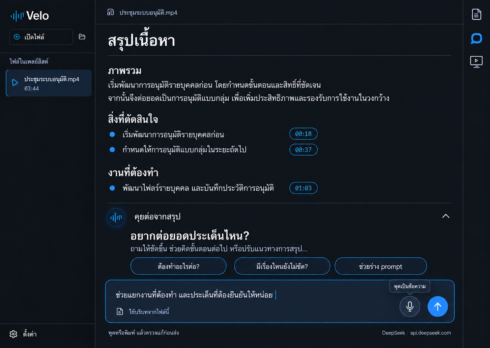

# Summary-first reading tools, content chat and dictation

Status: awaiting written-spec review; product implementation has not started.

## Intent and approved visual direction

The user selected the third displayed revision on 21 October 2026, then
approved these interaction refinements: summary is the default view;
transcript, chat and player use three right-hand rail icons; chat expands
inline underneath the summary, not in a separate column; and its composer
supports microphone dictation into an editable draft before manual Send.
This supersedes the original two-tool, transcript-first proposal.

The preview shows chat manually opened, not the startup state. The original
player-shelf reference remains in `assets/2026-10-21-reading-tools-selected.png`.

The image fixes hierarchy, placement and visual language, not its synthetic
meeting content. Use the existing theme tokens, Lucide icons and bilingual
strings. Do not introduce a different design system.

Use neutral copy: the main title is **สรุปเนื้อหา / Content summary**, the
transcript title is **บทถอดเสียง / Transcript**, the chat section is
**คุยต่อจากสรุป / Discuss this summary**, and the composer placeholder is
**ถามเกี่ยวกับเนื้อหา หรือบอกแนวทางการสรุป… / Ask about the content or describe
how you want it summarized…**. Meeting/work discussion remains the primary
use case, not a restriction in the navigation or a classification made by AI.
This iteration does not change the existing five-section summary contract;
unknown owners, decisions and deadlines must not be invented for other media.

Chat discusses the current recording and drafts better summary instructions;
it is not a general chat application. Chat, dictation and a native video
viewport make this an architectural change under the brainstorming workflow.
Conversational approval allows this revised spec; written-spec review and
implementation-plan review still precede product implementation.

## Existing constraints

- Preserve the uncommitted reading-workspace, prompt, timestamp and seek-toast
  work on `codex/summary-prompt-controls`; do not reset or fold it into this
  design-only commit.
- Follow `PLAN.md`, especially sections 9, 13, 15 and 31. Rust owns HTTP and
  credentials. Feature modules meet through `commands/`.
- macOS currently renders through mpv's render API into an `NSOpenGLView`.
  `sync_video_surface` resets that view to the whole window. Windows currently
  hands mpv the parent HWND. A transparent CSS hole alone would crop a large
  video rather than fit it into the selected preview.
- Reuse Ollama, OpenAI-compatible and DeepSeek provider settings and OS
  credential storage. No API keys in frontend state or settings files.
- No automatic model call, transcript generation, download or summarization.
  Tool visibility is not a generation trigger.

## Interaction contract

### Reading and tool visibility

- On each app launch, show the full-window **summary** view, regardless of
  media availability, with transcript, chat and player inactive. A missing
  summary uses the existing setup/generate states, never an automatic AI call.
- Remove the transcript/summary text tabs and large view-switch buttons. A
  persistent right rail has exactly three icon-only controls, in order:
  transcript (document/captions), chat (speech bubble), player (monitor-play).
  Each has a localized tooltip, accessible name, visible keyboard focus,
  and `aria-controls`. Chat/player expose `aria-expanded`; the transcript
  view toggle exposes `aria-pressed`. Active icons use the accent color.
- The transcript control switches the entire main reading area to the
  transcript, never a small drawer; pressing it again returns to summary.
  Both readers stay mounted so search, scroll, summary options and drafts
  survive. The title changes with the view. No media or model call is made.
- Chat expands below the summary in the same reading column. Opening it from
  transcript returns to summary and reveals chat; it does not create another
  panel or change source data. On first opening, scroll the chat heading into
  view. Subsequent reading is not forcibly scrolled away by streamed text.
- Switching to transcript hides chat without clearing its open preference.
  Returning to summary restores it. The icon is active only while chat is
  actually visible. Clicking it while visible collapses chat.
- Chat and player can both be open on desktop: inline conversation scrolls
  with the summary; the player shelf stays below the reader. The rail remains
  reachable, and there is no right-hand chat column.
- Close buttons affect their own tool only. Closing either does not clear
  text, reload media, seek, pause, reset speed or stop an AI response.
  Microphone capture is the exception: concealment stops/discards active
  capture as specified below, so a hidden microphone never keeps listening.
- Escape closes the focused tool and restores focus to its rail button,
  unless an inner modal or input owns Escape. Buttons also work through
  native Enter/Space activation without reaching global playback shortcuts.
- Opening a new file returns to summary and collapses chat/player. Conversation
  and composer state remain scoped to their file within this app session.
- At narrow/short sizes, chat remains inline, never becomes a right drawer.
  The reader scrolls; suggestions wrap and the composer remains reachable.
  At 640x400 the shelf uses compact controls and a smaller preview; tools must
  not shrink the reader below 160 logical pixels in height. If necessary,
  opening the player temporarily conceals chat; reopening chat closes that
  compact shelf, without clearing either tool's data. The transcript stays a
  full reading view. Preserve responsive playlist/settings access.

### Inviting inline composer

The expanded chat's empty state has a compact waveform mark, **คุยต่อจากสรุป**,
a short **อยากต่อยอดประเด็นไหน? / What would you like to explore?** heading,
and three lightweight starters: next actions, unclear points and prompt
drafting. Selecting a starter fills the composer for review; it never sends.
If a draft already exists, confirm replacement or let the person cancel.

Use a generous multiline composer with restrained accent border, file-context
label, separate microphone and Send controls, and provider/destination text.
Do not enclose the whole conversation in nested cards. Once messages exist,
the thread replaces the large welcome text and starters; the composer and
context remain. Preserve the revised mock's dark/light theme compatibility,
readable type, and keyboard focus. All assistant messages remain visible when
the chat is reopened; opening it does not reset to the welcome state.

### Player shelf

- Replace the always-visible reading transport and labeled Watch video action
  with the rail toggle. The open shelf contains a real aspect-fit native video
  preview, existing playback/seek/volume/speed controls and a close button.
- Audio-only files show a compact audio treatment, not an empty black video
  rectangle. No-file state offers the existing Open file action.
- Hiding the shelf leaves playback running. Reader timestamp links still seek
  while it is hidden and do not open it automatically.
- The shelf's expand action enters the existing large-video mode. Returning to
  reading restores the open shelf; closing it returns to unobstructed reading.
  Do not create a second mpv instance, decode video in HTML, or send frames
  through IPC.

## Native video viewport

Introduce a small player IPC operation accepting a logical webview rectangle
`{ x, y, width, height }` and a visibility flag. Geometry must be finite,
nonnegative and clamped to the current client area. It is UI geometry, never
an arbitrary native handle supplied by JavaScript.

The preview element reports its rectangle after layout using ResizeObserver
and coalesced animation-frame updates. Scroll, tool changes, window resize,
fullscreen and display scale changes refresh the rectangle. Discard stale
geometry updates with a monotonically increasing layout revision. No media
commands are issued by a geometry update.

On macOS, move/resize the existing GL view on the main thread, converting
top-left webview coordinates to AppKit coordinates. Its backing conversion
continues to determine render pixels. Window resize must reapply the selected
viewport rather than reset it to full-window bounds. On Windows, use an owned
child HWND as the mpv target, update its client rectangle on the UI thread,
and keep it below the webview. Clean it up with its owning window.

Only the exact preview rectangle is transparent in reading mode; other
surfaces remain opaque, including overlays and modals. An open opaque overlay
covering the preview temporarily conceals the native surface. Hidden mode
must not break audio timing or mpv's render lifecycle. A rendering failure
shows an actionable error rather than a fake still preview.

## File-scoped content chat

### Scope and lifetime

- One in-memory conversation per canonical media path for the app session.
  Returning to a file restores that conversation and composer draft; app exit
  clears them. No new disk chat history in this iteration. Label this clearly.
- A cached transcript is required; a summary is optional context. No transcript
  shows a link to the existing transcript flow, with Send disabled. Opening
  chat never starts transcription or downloads a model.
- Use the configured summary provider/model. Display its name and destination
  host before Send, with a non-loopback text-sharing notice. Send transmits
  selected transcript text, summary text and conversation text, never media.
- The model answers about supplied material, cites source timestamps, says
  when information is absent, and distinguishes inference from meeting facts.
  This is a prompt contract, not a guarantee of model accuracy.
- Transcript/summary content is untrusted quoted material, not instructions.
  No tool execution, filesystem access, external URLs or agent actions.

### Requests and state ownership

Add an independent Rust `chat/` module for context selection, prompt building
and cancellable inference. The command layer loads the transcript and optional
summary and passes owned snapshots into it; the module does not reach into
other feature stores. Reuse the existing provider transport and credential
access, preserving summary behavior and its tests.

Frontend `chatStore`, `chatService` and typed messages own presentation and
per-file drafts. Rust holds the authoritative active request and context.
There is one active chat request at a time. Sending while a summary is running
is disabled, and vice versa; enforce the exclusion in Rust as well as the UI.

`chat_send(path, request_id, message, history)` starts one streaming turn;
`chat_cancel(request_id)` cancels that turn. History consists only of completed
user/assistant pairs, validated in Rust. Events carry canonical path and
request ID: `velo://chat-delta`, `velo://chat-ready`, `velo://chat-error`.
Each delta also has a monotonically increasing sequence number. Duplicate,
out-of-order or superseded deltas are ignored. Late events cannot append to
another file's messages or finish another request.

Switching files or changing provider settings cancels the active request.
Hiding chat or switching to transcript does not. A cancelled/failed response
remains visibly partial, excluded from future context; Retry resends the same
turn without duplicating its user message. Stop cancels the underlying HTTP
stream, not just its UI.
No automatic retry that could duplicate a billed request.

### Bounded context

Build the complete serialized prompt against the configured context budget,
using the existing conservative byte heuristic and reserving answer space.
This is an estimate, not a tokenizer guarantee. Reject an invalid/too-small
budget rather than underflowing it. Bound user messages to 8 KiB, keep at most
six recent complete conversation pairs, and cap answers at 2048 tokens.
Evict oldest pairs before source material and indicate omitted history.

Use the full transcript when it fits. For longer recordings, use deterministic
lexical retrieval over transcript segments with Thai character n-grams and
Latin words, including neighboring segments and explicitly requested time
ranges. Break oversized segments at UTF-8 boundaries, retain their timestamp,
deduplicate overlaps, then order excerpts chronologically. Fill only the
remaining budget. Do not add embeddings, a database, or hidden AI map passes.

Always disclose whether the model received the complete transcript or selected
excerpts. Limited-context answers must not claim to have reviewed the entire
meeting. If a global question cannot be supported by the available summary
and selected excerpts, explain the limit and ask for a narrower topic. Source
selection and its budget arithmetic are pure Rust functions with unit tests.

Render generated text safely without raw HTML or executable Markdown links.
Only timestamps matching supplied source segments become seek controls; other
timestamp-like text remains plain text. Do not imply citation validation proves
that the answer is correct. Existing summary timestamp visibility preferences
also control visible chat source chips.

### Drafting summary instructions

A person may ask chat for a prompt. Answers remain conversational Markdown;
do not require the model to return a large JSON schema. The prompt builder
asks a requested draft to be placed in one fenced `prompt` block. An
unambiguous block offers Use this prompt; otherwise the person can open the
existing prompt editor and write/copy their own draft.

Use this prompt opens an editable draft in `SummaryPromptEditor`, not a direct
settings write. Saving explicitly replaces the existing global
`summary.instructions`, with the current all-files scope warning. Cancel
preserves the prior setting. Saving does not change a running summary, replace
the saved summary, or invoke AI. Regeneration remains the existing deliberate
Summarize/Regenerate action. A late chat answer never overwrites a newer draft.

## Microphone dictation into the composer

### User-visible behavior

- This is speech-to-text for a short chat question, not meeting recording,
  voice calling or an audio message to the provider. The mic icon is next to,
  but visually distinct from, Send. Permission is requested only after an
  explicit mic click. No permission prompt or capture on startup/tool opening.
- Reuse the installed local Whisper model; no cloud speech service or silent
  model download. If unavailable, link to the existing model setup and keep
  normal text chat working. A transcript alone does not imply a model exists.
- State machine: idle -> requesting permission -> recording -> transcribing
  -> reviewable text -> idle. Errors return to idle without deleting a draft.
  While recording, show an unmistakable active mic/Stop button and elapsed
  time. A second click stops capture and begins transcription. Cancel discards
  the capture. Stop automatically at 60 seconds; do not continuously listen.
- The existing draft remains intact during capture. After transcription, show
  a proposed insertion before committing it to the composer. Insert appends
  to the current draft, with a separator; Discard preserves it unchanged.
  Never replace edits made while transcription was running. The inserted text
  remains editable, and only a later Send starts a chat inference request.
- Empty/silent capture produces a recoverable message, not fabricated text.
  Permission denial, unavailable device, busy model and transcription failure
  have distinct localized recovery paths. No permission retry loop.
- Hiding chat, switching to transcript, changing files, opening another app
  (window blur after the OS permission dialog has resolved), or closing Velo
  cancels capture/transcription and releases the mic. It never inserts a late
  result into a different file. A completed draft is not cleared. Disable
  Send while capture or dictation transcription is active.
- To prevent the recording capturing Velo's own audio, pause playing media
  before capture; display that it was paused, and do not auto-resume playback.
  This explicit mic action is the only visibility-related playback exception.

### Boundaries and resources

Add an independent Rust `dictation/` service with a platform input-capture
adapter, a bounded in-memory PCM buffer and cancellation/session identity.
Normalize the default input device's audio to 16 kHz mono `f32` before calling
the existing Whisper engine. The command layer connects dictation to model
availability/engine invocation; it must never use the transcript file job or
overwrite cached recording transcripts. Release PCM buffers after completion
or cancellation; do not save microphone audio or dictated text to disk/logs.

Use explicit start/stop/cancel IPC commands and events keyed by canonical
media path and dictation session ID. No raw audio crosses the webview or goes
to a model provider. Serialize Whisper use with media transcription in Rust,
not only by disabled UI controls. A busy engine reports an error rather than
starting a second expensive model instance. Keep callbacks bounded and do
transcription/resampling outside real-time capture callbacks.

The app bundle must declare a localized microphone usage description and
honor OS permission/device access on macOS and Windows. Capturing audio
requires a new native input adapter; the current repo has no microphone
capture implementation. The implementation plan must pin its capture backend,
permission API, resampling strategy and dependency review before code changes.
No fallback to browser/cloud speech recognition. OS or model unavailability
must leave ordinary text entry and summarization usable.

## Error and privacy behavior

Handle missing configuration/key, connection failure, authentication failure,
rate limit, context overflow, timeout, empty answer and truncated stream with
localized recovery text. Keep user drafts and the last complete conversation.
Reuse provider-specific thinking-off, UTF-8 streaming and output validation.
Never expose reasoning text, API keys or raw authenticated error bodies.

No request occurs on startup, opening a tool, seeking, changing files, or
applying a prompt. Production logs omit chat/source text, credentials and
full sensitive paths. Only the explicitly configured host receives inference
requests; redirects must not forward authorization to a different host. No
cloud fallback. Do not change the installed app's settings or keychain for QA.

## Verification and acceptance

Write failing behavior tests before implementation. Tests must invoke real
store/component interactions, not rely solely on searching rendered strings.

- Frontend: summary default and all three rail icons inactive initially;
  transcript full-reader toggle and inline chat switching/restoration;
  repeated rail clicks/close buttons; keyboard activation/Escape/focus;
  compact-player constraints; no playback/model IPC from visibility toggles;
  reader state retained; welcome/starters versus existing conversation;
  hidden-player playback and citations; chat history/file switching, duplicate
  events, cancellation/retry and provider changes; prompt draft/save/cancel;
  safe rendering and timestamp preference; Thai/English accessible labels;
  mic permission/start/stop/cancel, pause-without-resume, stale dictation,
  append confirmation against concurrent draft edits, no automatic Send.
- Rust: context size boundaries, Thai/UTF-8 selection and grounding metadata;
  request identity and cancellation; chat/summary exclusion; mock Ollama,
  OpenAI-compatible and DeepSeek requests/streaming/failures; no media payload
  or credential leak; native viewport validation and coordinate conversion;
  bounded microphone buffers, normalization, 60-second limit, silence, engine
  exclusion, cancellation and no microphone cache writes.
- Native macOS QA: real synthetic moving video and audio-only input, hidden
  playback, aspect-fit preview, resize/Retina/fullscreen, both tools together,
  overlays, minimum window 640x400, keyboard editing, both themes and locales;
  dictation using injected synthetic samples and permission/device errors.
  Use an isolated test app identifier/data directory. Do not replace
  `/Applications/Velo.app` or call a paid provider using the user's key.
- Physical microphone QA is user-assisted: the user initiates capture after
  knowing what is recorded. Without it, report real-device/OS permission and
  recognition-quality checks as unverified, not covered by synthetic tests.
- Run `cargo fmt`, `cargo clippy --all-targets -- -D warnings`, `cargo test`,
  `npm run typecheck`, `npm run lint`, and `npx vitest run`; additionally run
  version/release-script checks and a macOS app bundle build because native
  surface code changes. Report optional live-test skips explicitly.
- Windows native viewport needs Windows compilation plus real-window QA.
  If no Windows runner is available, explicitly report that gap; do not claim
  Windows preview behavior verified from macOS tests.

Success means summary is the default with three inactive rail icons,
transcript occupies the full reader when selected, chat opens inline, and
player visibility does not interrupt audio. Video genuinely fits its preview,
chat stays within the correct file, dictation requires review/manual Send,
and neither discussion nor prompt saving silently regenerates the summary.

## Deliberate exclusions and next gate

No persistent chat archive, multiple threads per file, uploads, web search,
voice conversation, meeting recording, cloud speech recognition, embeddings,
new account system, automatic summary replacement, new provider integrations,
version bump, PR, push, merge or release. Short offline composer dictation is
explicitly in scope, not the excluded continuous-recording features.

The user reviews this written spec next. After approval, prepare the detailed
implementation plan and request its review/execution method before product
code changes. This document does not claim implementation or test completion.
