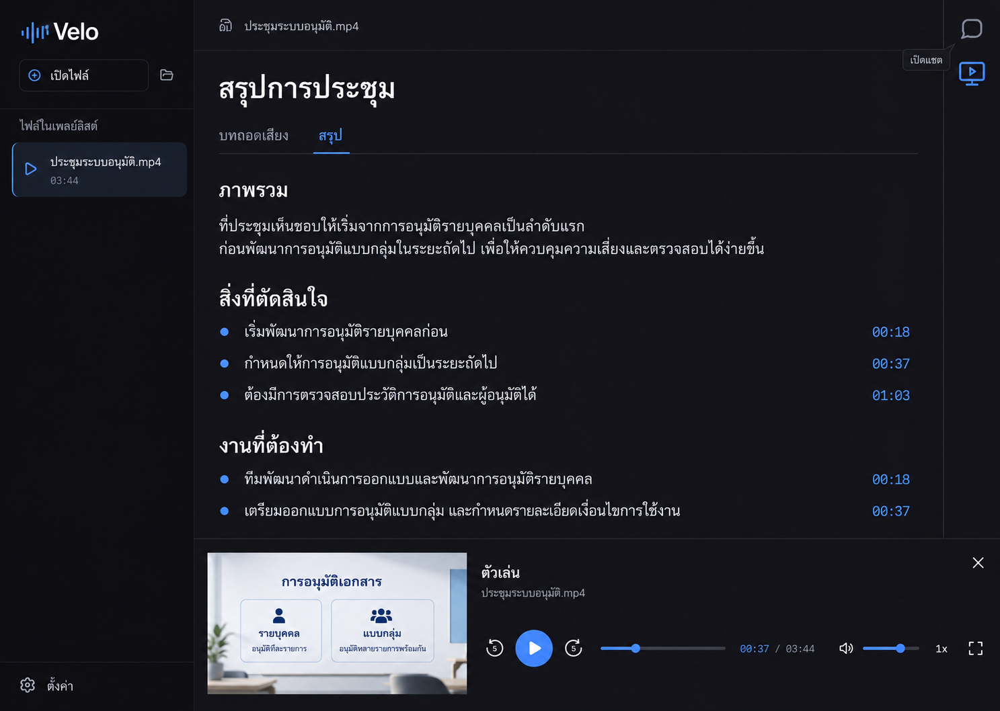

# On-demand reading tools and meeting chat

Status: awaiting written-spec review; product implementation has not started.

## Intent and approved visual direction

The user selected the third displayed revision on 21 October 2026: a reading
workspace with a narrow right-hand tool rail and an optional media shelf.
Chat and player start hidden. Clicking either icon opens its tool; clicking
the same icon again closes it. Reading remains the primary activity.

The image fixes hierarchy, placement and visual language, not its synthetic
meeting content. Use the existing theme tokens, Lucide icons and bilingual
strings. Do not introduce a different design system.

The accompanying chat lets a person discuss the current recording, ask about
a summary, and draft better summary instructions. It is not a general chat
application. Adding this subsystem and a native video viewport makes this an
architectural change under the brainstorming workflow. Visual approval allows
this spec; written-spec review and implementation-plan review still precede
implementation.

## Existing constraints

- Preserve the uncommitted reading-workspace, prompt, timestamp and seek-toast
  work on `codex/summary-prompt-controls`; do not reset or fold it into this
  design-only commit.
- Follow `PLAN.md`, especially sections 9, 13, 15 and 31. Rust owns HTTP and
  credentials. Feature modules meet through `commands/`.
- macOS currently renders through mpv's render API into an `NSOpenGLView`.
  `sync_video_surface` resets that view to the whole window. Windows currently
  hands mpv the parent HWND. A transparent CSS hole alone would crop a large
  video rather than fit it into the selected preview.
- Reuse Ollama, OpenAI-compatible and DeepSeek provider settings and OS
  credential storage. No API keys in frontend state or settings files.
- No automatic model call, transcript generation, download or summarization.
  Tool visibility is not a generation trigger.

## Interaction contract

### Reading and tool visibility

- On each app launch, show the full-window reader with both tools closed,
  regardless of media availability. Keep the selected transcript/summary tab.
- A persistent right rail has two icon-only buttons: chat and monitor-play.
  Each has a localized tooltip, accessible name, visible keyboard focus,
  `aria-expanded` and `aria-controls`. Active icons use the accent color.
- Chat and player are independent toggles on desktop. Both may be open: chat
  occupies a right column, the player shelf occupies the bottom of the
  remaining reading column, and the rail stays reachable.
- Close buttons affect their own tool only. Closing either does not clear
  text, reload media, seek, pause, reset speed or stop an AI response.
- Escape closes the focused tool and restores focus to its rail button,
  unless an inner modal or input owns Escape. Buttons also work through
  native Enter/Space activation without reaching global playback shortcuts.
- Opening a new file collapses both tools. Conversation state remains scoped
  to its file. Switching tabs does not discard search, reader scroll or drafts.
- Before shrinking the reading column below 320 logical pixels, tools become
  mutually exclusive overlays. Opening one closes the other, without clearing
  either tool's data. At 640x400, the player uses compact controls and a smaller
  preview; chat has its own scroll area and a reachable composer/close button.
- A tool overlay must not cover the other tool's trigger. Preserve the
  responsive playlist drawer and settings access.

### Player shelf

- Replace the always-visible reading transport and labeled Watch video action
  with the rail toggle. The open shelf contains a real aspect-fit native video
  preview, existing playback/seek/volume/speed controls and a close button.
- Audio-only files show a compact audio treatment, not an empty black video
  rectangle. No-file state offers the existing Open file action.
- Hiding the shelf leaves playback running. Reader timestamp links still seek
  while it is hidden and do not open it automatically.
- The shelf's expand action enters the existing large-video mode. Returning to
  reading restores the open shelf; closing it returns to unobstructed reading.
  Do not create a second mpv instance, decode video in HTML, or send frames
  through IPC.

## Native video viewport

Introduce a small player IPC operation accepting a logical webview rectangle
`{ x, y, width, height }` and a visibility flag. Geometry must be finite,
nonnegative and clamped to the current client area. It is UI geometry, never
an arbitrary native handle supplied by JavaScript.

The preview element reports its rectangle after layout using ResizeObserver
and coalesced animation-frame updates. Scroll, tool changes, window resize,
fullscreen and display scale changes refresh the rectangle. Discard stale
geometry updates with a monotonically increasing layout revision. No media
commands are issued by a geometry update.

On macOS, move/resize the existing GL view on the main thread, converting
top-left webview coordinates to AppKit coordinates. Its backing conversion
continues to determine render pixels. Window resize must reapply the selected
viewport rather than reset it to full-window bounds. On Windows, use an owned
child HWND as the mpv target, update its client rectangle on the UI thread,
and keep it below the webview. Clean it up with its owning window.

Only the exact preview rectangle is transparent in reading mode; other
surfaces remain opaque, including overlays and modals. An open opaque overlay
covering the preview temporarily conceals the native surface. Hidden mode
must not break audio timing or mpv's render lifecycle. A rendering failure
shows an actionable error rather than a fake still preview.

## File-scoped chat

### Scope and lifetime

- One in-memory conversation per canonical media path for the app session.
  Returning to a file restores that conversation and composer draft; app exit
  clears them. No new disk chat history in this iteration. Label this clearly.
- A cached transcript is required; a summary is optional context. No transcript
  shows a link to the existing transcript flow, with Send disabled. Opening
  chat never starts transcription or downloads a model.
- Use the configured summary provider/model. Display its name and destination
  host before Send, with a non-loopback text-sharing notice. Send transmits
  selected transcript text, summary text and conversation text, never media.
- The model answers about supplied material, cites source timestamps, says
  when information is absent, and distinguishes inference from meeting facts.
  This is a prompt contract, not a guarantee of model accuracy.
- Transcript/summary content is untrusted quoted material, not instructions.
  No tool execution, filesystem access, external URLs or agent actions.

### Requests and state ownership

Add an independent Rust `chat/` module for context selection, prompt building
and cancellable inference. The command layer loads the transcript and optional
summary and passes owned snapshots into it; the module does not reach into
other feature stores. Reuse the existing provider transport and credential
access, preserving summary behavior and its tests.

Frontend `chatStore`, `chatService` and typed messages own presentation and
per-file drafts. Rust holds the authoritative active request and context.
There is one active chat request at a time. Sending while a summary is running
is disabled, and vice versa; enforce the exclusion in Rust as well as the UI.

`chat_send(path, request_id, message, history)` starts one streaming turn;
`chat_cancel(request_id)` cancels that turn. History consists only of completed
user/assistant pairs, validated in Rust. Events carry canonical path and
request ID: `velo://chat-delta`, `velo://chat-ready`, `velo://chat-error`.
Each delta also has a monotonically increasing sequence number. Duplicate,
out-of-order or superseded deltas are ignored. Late events cannot append to
another file's messages or finish another request.

Switching files or changing provider settings cancels the active request.
Hiding chat does not. A cancelled/failed response remains visibly partial,
excluded from future context; Retry resends the same turn without duplicating
its user message. Stop cancels the underlying HTTP stream, not just its UI.
No automatic retry that could duplicate a billed request.

### Bounded context

Build the complete serialized prompt against the configured context budget,
using the existing conservative byte heuristic and reserving answer space.
This is an estimate, not a tokenizer guarantee. Reject an invalid/too-small
budget rather than underflowing it. Bound user messages to 8 KiB, keep at most
six recent complete conversation pairs, and cap answers at 2048 tokens.
Evict oldest pairs before source material and indicate omitted history.

Use the full transcript when it fits. For longer recordings, use deterministic
lexical retrieval over transcript segments with Thai character n-grams and
Latin words, including neighboring segments and explicitly requested time
ranges. Break oversized segments at UTF-8 boundaries, retain their timestamp,
deduplicate overlaps, then order excerpts chronologically. Fill only the
remaining budget. Do not add embeddings, a database, or hidden AI map passes.

Always disclose whether the model received the complete transcript or selected
excerpts. Limited-context answers must not claim to have reviewed the entire
meeting. If a global question cannot be supported by the available summary
and selected excerpts, explain the limit and ask for a narrower topic. Source
selection and its budget arithmetic are pure Rust functions with unit tests.

Render generated text safely without raw HTML or executable Markdown links.
Only timestamps matching supplied source segments become seek controls; other
timestamp-like text remains plain text. Do not imply citation validation proves
that the answer is correct. Existing summary timestamp visibility preferences
also control visible chat source chips.

### Drafting summary instructions

A person may ask chat for a prompt. Answers remain conversational Markdown;
do not require the model to return a large JSON schema. The prompt builder
asks a requested draft to be placed in one fenced `prompt` block. An
unambiguous block offers Use this prompt; otherwise the person can open the
existing prompt editor and write/copy their own draft.

Use this prompt opens an editable draft in `SummaryPromptEditor`, not a direct
settings write. Saving explicitly replaces the existing global
`summary.instructions`, with the current all-files scope warning. Cancel
preserves the prior setting. Saving does not change a running summary, replace
the saved summary, or invoke AI. Regeneration remains the existing deliberate
Summarize/Regenerate action. A late chat answer never overwrites a newer draft.

## Error and privacy behavior

Handle missing configuration/key, connection failure, authentication failure,
rate limit, context overflow, timeout, empty answer and truncated stream with
localized recovery text. Keep user drafts and the last complete conversation.
Reuse provider-specific thinking-off, UTF-8 streaming and output validation.
Never expose reasoning text, API keys or raw authenticated error bodies.

No request occurs on startup, opening a tool, seeking, changing files, or
applying a prompt. Production logs omit chat/source text, credentials and
full sensitive paths. Only the explicitly configured host receives inference
requests; redirects must not forward authorization to a different host. No
cloud fallback. Do not change the installed app's settings or keychain for QA.

## Verification and acceptance

Write failing behavior tests before implementation. Tests must invoke real
store/component interactions, not rely solely on searching rendered strings.

- Frontend: both hidden initially; repeated rail clicks and close buttons;
  keyboard activation/Escape/focus; desktop independence and narrow mutual
  exclusion; no playback/model IPC from toggles; reader state retained;
  hidden-player playback and citations; chat history/file switching, duplicate
  events, cancellation/retry and provider changes; prompt draft/save/cancel;
  safe rendering and timestamp preference; Thai/English accessible labels.
- Rust: context size boundaries, Thai/UTF-8 selection and grounding metadata;
  request identity and cancellation; chat/summary exclusion; mock Ollama,
  OpenAI-compatible and DeepSeek requests/streaming/failures; no media payload
  or credential leak; native viewport validation and coordinate conversion.
- Native macOS QA: real synthetic moving video and audio-only input, hidden
  playback, aspect-fit preview, resize/Retina/fullscreen, both tools together,
  overlays, minimum window 640x400, keyboard editing, both themes and locales.
  Use an isolated test app identifier/data directory. Do not replace
  `/Applications/Velo.app` or call a paid provider using the user's key.
- Run `cargo fmt`, `cargo clippy --all-targets -- -D warnings`, `cargo test`,
  `npm run typecheck`, `npm run lint`, and `npx vitest run`; additionally run
  version/release-script checks and a macOS app bundle build because native
  surface code changes. Report optional live-test skips explicitly.
- Windows native viewport needs Windows compilation plus real-window QA.
  If no Windows runner is available, explicitly report that gap; do not claim
  Windows preview behavior verified from macOS tests.

Success means the selected reading-first layout works with both tools closed,
each icon predictably toggles its tool, video genuinely fits its preview,
audio continues while hidden, chat stays within the correct file, and neither
discussion nor prompt saving silently regenerates the summary.

## Deliberate exclusions and next gate

No persistent chat archive, multiple threads per file, uploads, web search,
voice input, embeddings, new account system, automatic summary replacement,
new provider integrations, version bump, PR, push, merge or release.

The user reviews this written spec next. After approval, prepare the detailed
implementation plan and request its review/execution method before product
code changes. This document does not claim implementation or test completion.
